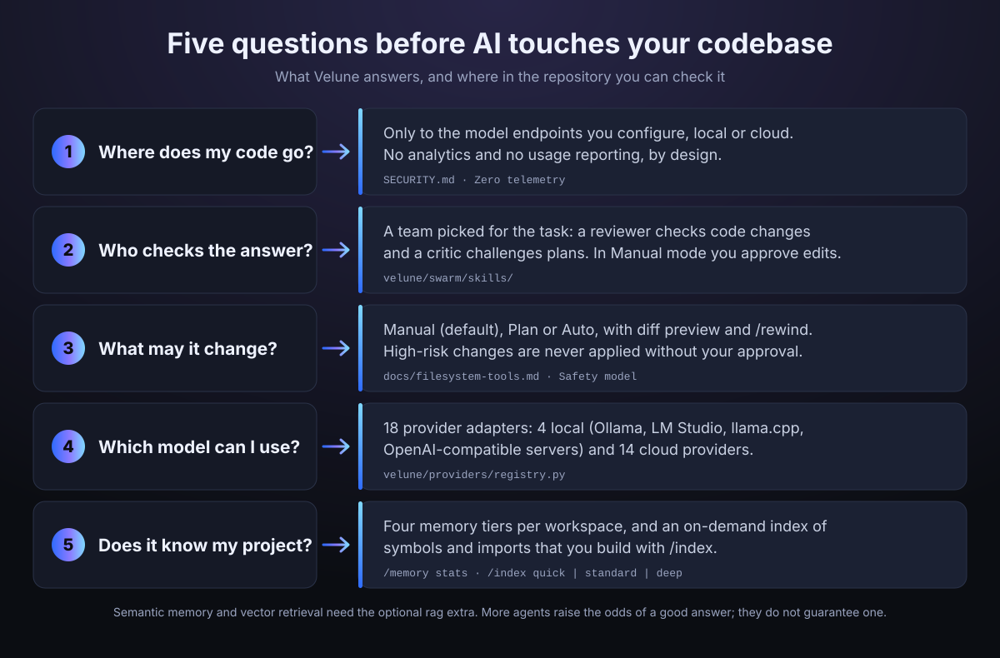
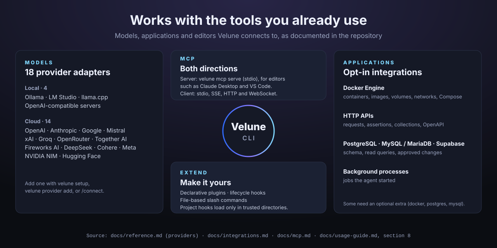
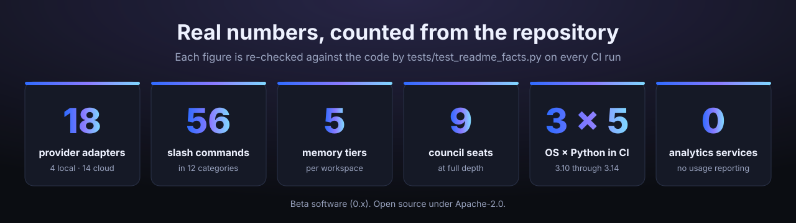

<div align="center">


<h1>Velune CLI</h1>

<h3>Your models. Your machine. Your approval.</h3>

<p>An open-source, local-first AI engineer for your terminal.</p>

<p><a href="https://velune-cli.vercel.app/"><strong>Visit the website →</strong></a></p>

<p>
<a href="https://pypi.org/project/velune-cli/"></a>
<a href="https://pypi.org/project/velune-cli/"></a>
<a href="https://github.com/Surya-Hariharan/Velune-CLI/actions/workflows/ci.yml"></a>
<a href="https://github.com/Surya-Hariharan/Velune-CLI/blob/main/LICENSE"></a>
<a href="https://github.com/Surya-Hariharan/Velune-CLI"></a>
</p>

<p>


</p>

</div>

---

## Here's the deal.

AI can write code. Fine. The real question is whether you let it near the codebase that pays your bills.

You've got five worries, and they're all fair:

<div align="center">

</div>

Velune answers every one of them. And every answer points at a file in this repo. Don't take my word for it. Go check.

## What you get

- 🔒 **Your code stays yours.** Run a model on your own machine. No analytics, no usage data sent to us
  ([proof](https://github.com/Surya-Hariharan/Velune-CLI/blob/main/SECURITY.md#zero-telemetry)).
- 🧠 **A council, not a lone gun.** Easy question? One seat. Big refactor? Up to nine seats, including a Challenger
  whose whole job is to poke holes in the plan.
- 🛡️ **You hold the leash.** Manual by default. Every change is a diff you approve. One command to undo.
- 📚 **It remembers.** Five memory tiers per project, so it knows your code before you explain it.

<div align="center">

</div>

<div align="center">

</div>

It works like this:

```text
/plan add input validation to signup     it investigates and writes a plan. No file touched.
approve                                  it runs the plan. You see every diff first.
/diff                                    see exactly what changed
/rewind                                  don't like it? Undo the agent's last turn.
```

A council raises your odds of a good answer. It doesn't promise one. It costs more calls than a single model, so it only
shows up when the task needs it. Read your diffs.

## Plugs into everything

<div align="center">

</div>

## The numbers

No hype. Counted from the code. A test recomputes them on every CI run and fails if they drift.

<div align="center">

</div>

The honest part: this is **beta**. Things change between releases. Command execution is process management, not an
OS-level sandbox (a Docker sandbox is opt-in). The full list of limits is in
[SECURITY.md](https://github.com/Surya-Hariharan/Velune-CLI/blob/main/SECURITY.md).

## Get in. Two minutes.

**macOS, Linux, WSL**

```bash
curl -fsSL https://raw.githubusercontent.com/Surya-Hariharan/Velune-CLI/main/scripts/install.sh | sh
```

**Windows (PowerShell)**

```powershell
irm https://raw.githubusercontent.com/Surya-Hariharan/Velune-CLI/main/scripts/install.ps1 | iex
```

Or `pipx install velune-cli` / `uv tool install velune-cli`. The installer needs no existing Python.

**Updates:** when a new release is out, Velune asks once whether to install it, then updates itself after you quit.
To update by hand, **close every Velune window first**, then re-run the installer (or `velune update`). Replacing a
running Velune can delete its files part-way, so the installer refuses while Velune is open.

Installed with plain `pip` and `velune` says "not recognized" (or "command not found")? The install worked; Python's
Scripts folder just isn't on your `PATH` (pip prints "WARNING: The scripts velune.exe ... are installed in ... which is
not on PATH"). Run `python -m velune doctor --fix`, which works without it and adds the folder to your user `PATH`;
then open a new terminal. Or install with `pipx` (then `pipx ensurepath`).

Then pick your lane:

```bash
# Fully local
ollama pull qwen2.5-coder:7b
cd your-project && velune init && velune

# Cloud (Groq free tier)
cd your-project && velune init --provider groq && velune setup && velune
```

Something off? Run `velune doctor` (or `python -m velune doctor` if `velune` isn't found).

## Join in

One maintainer. Open doors.
[Open an issue](https://github.com/Surya-Hariharan/Velune-CLI/issues/new/choose) ·
[Contribute](https://github.com/Surya-Hariharan/Velune-CLI/blob/main/CONTRIBUTING.md) ·
[Report a vulnerability](https://github.com/Surya-Hariharan/Velune-CLI/security/advisories/new) (privately, never in a public issue).

**Go deeper:**
[Reference](https://github.com/Surya-Hariharan/Velune-CLI/blob/main/docs/reference.md) ·
[Usage guide](https://github.com/Surya-Hariharan/Velune-CLI/blob/main/docs/usage-guide.md) ·
[Slash commands](https://github.com/Surya-Hariharan/Velune-CLI/blob/main/docs/slash-commands.md) ·
[Security](https://github.com/Surya-Hariharan/Velune-CLI/blob/main/SECURITY.md) ·
[Changelog](https://github.com/Surya-Hariharan/Velune-CLI/blob/main/CHANGELOG.md)

---

<div align="center">

Licensed under [Apache 2.0](https://github.com/Surya-Hariharan/Velune-CLI/blob/main/LICENSE). Copyright 2026 Surya HA.
Third-party names belong to their owners and identify services Velune can connect to.
See [NOTICE](https://github.com/Surya-Hariharan/Velune-CLI/blob/main/NOTICE),
[AUTHORS](https://github.com/Surya-Hariharan/Velune-CLI/blob/main/AUTHORS.md) and the
[Code of Conduct](https://github.com/Surya-Hariharan/Velune-CLI/blob/main/CODE_OF_CONDUCT.md).

</div>
