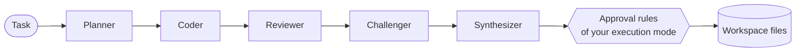
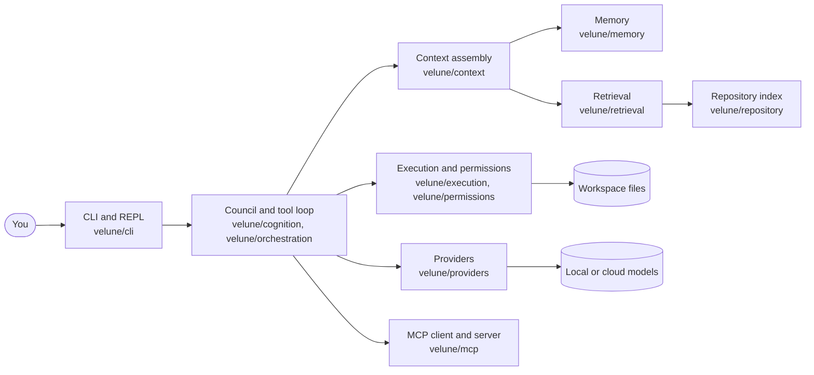

<div align="center">



<h1>Velune CLI</h1>

<p><strong>Local-first AI coding where a council reviews the change and you approve it.</strong></p>

<p>
A terminal AI assistant for real codebases. Run models on your own machine or on a cloud provider you choose; for harder
tasks Velune convenes a council of agents, and every change to your files passes through the execution mode you set.
</p>

<p>
<a href="https://pypi.org/project/velune-cli/"></a>
<a href="https://pypi.org/project/velune-cli/"></a>
<a href="https://github.com/Surya-Hariharan/Velune-CLI/actions/workflows/ci.yml"></a>
<a href="https://github.com/Surya-Hariharan/Velune-CLI/blob/main/LICENSE"></a>
<a href="https://github.com/Surya-Hariharan/Velune-CLI"></a>
</p>

<p>
<a href="#installation">Install</a> ·
<a href="#see-it-in-the-terminal">Terminal</a> ·
<a href="#why-velune">Why Velune</a> ·
<a href="#documentation">Docs</a> ·
<a href="#roadmap">Roadmap</a> ·
<a href="#contributing">Contribute</a>
</p>

</div>

```bash
curl -fsSL https://raw.githubusercontent.com/Surya-Hariharan/Velune-CLI/main/scripts/install.sh | sh
```

On Windows, use the [PowerShell installer](#installation). Velune CLI is **beta software**; read the
[project status](#project-status-security-and-license) before relying on it for important work.

## Installation

### Install Velune CLI

**macOS, Linux, WSL**

```bash
curl -fsSL https://raw.githubusercontent.com/Surya-Hariharan/Velune-CLI/main/scripts/install.sh | sh
```

**Windows (PowerShell)**

```powershell
irm https://raw.githubusercontent.com/Surya-Hariharan/Velune-CLI/main/scripts/install.ps1 | iex
```

The installer puts Velune in its own isolated environment using [uv](https://docs.astral.sh/uv/). It does not need
Python to be installed: if Python is missing or too old, uv downloads a private copy. It adds `velune` to your `PATH`,
and running the same command again upgrades the installation. The scripts are fetched from the `main` branch and uv's
own installer is fetched from `astral.sh`; read the scripts first if that trust is not acceptable.

<details>
<summary>Install with pipx, uv or pip instead, and fix common install problems</summary>

```bash
pipx install velune-cli          # isolated, PATH managed
uv tool install velune-cli       # isolated, PATH managed
python -m pip install velune-cli # into the current Python environment
```

Use `python -m pip`, not bare `pip`, so the package goes into the same Python you will run it with. Plain pip needs
Python 3.10 or newer. Common problems:

- **`Could not find a version that satisfies the requirement velune-cli`** (with a `Requires-Python` note): your Python
  is older than 3.10. Check `python --version`.
- **`externally-managed-environment`** (Debian, Ubuntu, Homebrew Python): the OS protects its Python. Use the installer,
  `pipx`, `uv tool`, or a virtualenv.
- **Conflicts with other tools' dependencies:** pip keeps one copy of each package per environment. An isolated install
  avoids this. If Velune detects an incompatible dependency at startup, it names the package and the fix command.
- **`velune: command not found`:** your Python scripts directory is not on `PATH`. Use `python -m velune`, or reinstall
  with `pipx` or the installer.

On the platforms marked **Tested** below, the core dependencies install from prebuilt wheels for CPython 3.10 to 3.14,
so no compiler is needed. CI checks this, including at the lowest allowed version of each dependency.

</details>

#### Platform support

| Platform | Status |
|---|---|
| Windows 10/11, x86-64 | **Tested** in CI |
| macOS, Apple Silicon (arm64) | **Tested** in CI |
| Linux, x86-64, glibc (Ubuntu, Debian, Fedora, …) | **Tested** in CI |
| Linux, arm64, glibc | Not tested. Prebuilt wheels exist for the core dependencies. |
| macOS, Intel (x86-64) | **Unverified.** In our lock file (`uv.lock`) the `cryptography` release has no macOS x86-64 wheel, so installing the base CLI may need a Rust toolchain to build it. The installer does not block it and it may work; we have not tested it or checked what PyPI currently offers. The optional `[rag]` extra is unavailable. |
| Alpine / other musl Linux | Not tested. Prebuilt wheels exist for the core dependencies. |
| WSL 2 | Not tested separately; treated as Linux. |
| **Windows on ARM64** | **Unsupported.** The installer stops before downloading anything. Required dependencies (`cryptography`, `tiktoken`) publish no Windows ARM64 wheels, so an install would need a Rust and C++ build toolchain. |
| 32-bit systems, BSD, other architectures | **Unsupported.** The installer stops before downloading anything. |

**Tested** means a CI job installs and runs it. **Not tested** means the
installer lets you proceed and our lock file has prebuilt wheels for the core
dependencies, so we expect it to work, but no CI job covers it. **Unverified**
means we found a gap that could make the install fail or need build tools, and
have not confirmed either way. **Unsupported** means the installer refuses to
run. None of these is a guarantee.

#### Verify the install

```bash
velune --version
velune doctor
```

`velune doctor` shows the Velune version, Python interpreter, operating system, and where Velune is installed and keeps
its data. It ends with "✓ Core installation is healthy." or a list of problems. Optional integrations (provider keys, a
local Ollama, extras such as `[rag]`) are reported but never counted as installation failures, and the exit code is
non-zero only when the core installation has a problem. `velune doctor --json` prints the same report as JSON with home
paths shortened to `~`, so it can be pasted into a bug report.

### Optional extras

The base install is small. Features that need heavier or compiled dependencies live in extras and turn themselves off
when the extra is missing (semantic search is disabled while keyword search keeps working).

| Extra | Enables |
| :--- | :--- |
| `rag` | Semantic memory and vector retrieval (`lancedb`, `pyarrow`, `qdrant-client`) |
| `parsing` | Tree-sitter parsing for repository cognition; lighter heuristics are used without it |
| `telemetry` | Export spans and metrics to an OTLP collector |
| `gguf`, `docker` | GGUF metadata reading; the Docker sandbox |
| `all` | Every optional feature |

```bash
pip install 'velune-cli[rag]'
uv tool install --force 'velune-cli[rag]'   # add an extra to a uv tool or installer install
pipx install --force 'velune-cli[rag]'      # add an extra to a pipx install
```

The `rag` extra depends on LanceDB, which publishes prebuilt wheels only for Windows x86-64, macOS Apple Silicon and
glibc Linux (x86-64 and arm64), so it cannot be installed on musl Linux, Intel Macs or Windows ARM64. There is also a
`git` extra, kept only for compatibility, and a `dev` extra for contributors. The former `llamacpp` extra was removed
because `llama-cpp-python` depends on `diskcache`, which deserializes cache entries with `pickle` and has no patched
release. The llama.cpp adapter remains in the code and is available only if you install `llama-cpp-python` yourself,
which is not recommended outside a trusted single-user environment.

**Python:** 3.10 to 3.14 (CPython). CI runs the test suite on every combination of these versions with Windows, macOS
and Linux.

## See it in the terminal

<div align="center">

</div>

The animation replays real output captured from Velune CLI 0.9.9 (`velune --version` and `velune --help`, shortened
after the *Setup and Models* group). It shows what is installed and where to start, not a full session. A recording of
a complete plan-review-approve workflow is on the [wish list](#ways-to-contribute).

A typical session in the REPL uses these real commands:

```text
/index standard                       build the symbol index (once, then kept fresh)
/model use <model-id>                 choose a connected model
/plan add input validation to signup  investigate and write a plan; no project files change
approve                               run the plan; each change is shown for approval in Manual mode
/diff                                 review what changed on disk
/undo                                 revert the last Velune-authored commit if you disagree
```

### Quickstart

<table>
<tr>
<td width="50%" valign="top">

**With a local model (Ollama)**

```bash
ollama pull qwen2.5-coder:7b
cd your-project
velune init
velune
```

Install Ollama from [ollama.com](https://ollama.com) first. For a remote Ollama, set `OLLAMA_HOST`.

</td>
<td width="50%" valign="top">

**With a cloud provider (Groq)**

```bash
cd your-project
velune init --provider groq
velune setup   # asks for your key
velune
```

Groq has a free tier; create a key at [console.groq.com/keys](https://console.groq.com/keys).

</td>
</tr>
</table>

`velune init` creates the project configuration and `.veluneignore` and builds the repository index (`--no-index` skips
it). Otherwise indexing is explicit: nothing is indexed when Velune starts. Run `velune doctor` at any time to check
your setup.

## Why Velune

Plenty of tools put a model in your terminal. Velune is built around four decisions, each of which exists in the code
today:

- **You choose where your prompts go.** Eighteen provider adapters cover local servers and cloud APIs. Velune has no
  analytics service, and a failed local model is not retried on a cloud provider unless you opt in.
- **Hard tasks get more than one opinion.** A council of five agents plans, writes, reviews and challenges the work, and
  the depth is chosen per task. Simple questions skip the council.
- **It remembers, and it reads your repository when you ask.** Five memory tiers persist per workspace, and indexing
  (symbols, import graph, blast radius) runs only on request.
- **You decide how much it may do.** Manual, Plan and Auto modes, path containment, diff preview and git snapshots keep
  the agent inside limits you set. This is process management, not a security sandbox; a Docker sandbox is available as
  an opt-in for real isolation.

It also speaks MCP in both directions, so editors can call Velune's tools and Velune can use other MCP servers.

## What you get

| | |
| :--- | :--- |
| **Council of agents**<br>Planner, Coder, Reviewer, Challenger and Synthesizer, scaled by task tier. `/fast`, `/normal` and `/max` pin the depth. | **Repository cognition**<br>On-demand index of files, symbols and the import graph, with blast-radius estimates and incremental updates. |
| **Persistent memory**<br>Working, episodic, semantic, graph and lineage tiers per workspace, with hybrid retrieval (BM25, vectors, graph). | **18 providers**<br>Ollama, LM Studio, OpenAI-compatible servers, Groq, OpenRouter, OpenAI, Anthropic, Google, Mistral and more. |
| **Controlled execution**<br>Manual, Plan and Auto modes, path guard, diff preview, git snapshots, resource-limited command runner. | **MCP both ways**<br>`velune mcp serve` for editors; connect to external servers over stdio, SSE, HTTP or WebSocket. |
| **Recovery tools**<br>`backup`, `restore` and crash `recover`, plus `doctor`, `status` and a trace log of what actually ran. | **Extensible**<br>Declarative plugins, lifecycle hooks, custom slash commands and resource connectors (Docker, Postgres, MySQL, Supabase). |

Experimental or opt-in: `velune native` (a read-only orchestration engine, off by default), the Docker sandbox, and the
`rag` and `parsing` extras.

## Multi-agent architecture

For tasks that need it, `/run` and `/council` pass the work through five agents in sequence. How many of them run is set
by the task tier (`instant`, `minimal`, `standard`, `full`), which Velune classifies from the prompt and from how many
files depend on the code you mention, unless you pin it with `/fast`, `/normal` or `/max`.



A council improves the odds of a good answer and does not guarantee one, and it costs more calls and time than a single
model. Read diffs before accepting them.

Around the council, Velune is one Python process. The CLI builds a runtime (configuration, providers and models first;
repository, memory, retrieval, execution and agent subsystems warm up in the background), then routes each request
through the provider layer. Heavy subsystems load lazily, so `velune --version` and `--help` start quickly.



<details>
<summary>Package map</summary>

| Package | Responsibility |
| :--- | :--- |
| `velune/cli` | Typer commands, full-screen REPL, slash commands, themes, onboarding |
| `velune/providers`, `velune/models` | Provider adapters, discovery, credentials, model registry and role mapping |
| `velune/cognition` | Council agents, debate, tier classification |
| `velune/orchestration` | Native tool-calling loop and the experimental native engine |
| `velune/memory`, `velune/retrieval` | Memory tiers, SQLite and vector stores, hybrid retrieval |
| `velune/repository`, `velune/intelligence`, `velune/knowledge` | Scanner, symbol and import index, incremental re-indexing, knowledge graph |
| `velune/execution`, `velune/permissions`, `velune/tools` | Command runner, path guard, diff preview, rollback, approval policy, tools |
| `velune/mcp`, `velune/hooks`, `velune/plugins`, `velune/resources` | MCP, lifecycle hooks, declarative plugins, Docker and database connectors |
| `velune/recovery`, `velune/lifecycle` | Backup, restore, crash recovery; update, repair, uninstall |

Module boundaries and the bootstrap sequence are in
[docs/development.md](https://github.com/Surya-Hariharan/Velune-CLI/blob/main/docs/development.md).

</details>

## Local and cloud providers

- **Local providers** send prompts to the endpoint you configured. That is your own machine by default, but a remote
  `OLLAMA_HOST` or an OpenAI-compatible server on another host receives your prompts and repository context.
- **Cloud providers** receive the prompt and whatever repository or memory context Velune includes. Their retention and
  training policies are set by the provider, not by Velune.
- A council seat whose local model fails is not retried on a cloud provider unless you set
  `providers.allow_cloud_fallback_from_local = true`. Review `providers.fallback_providers` before enabling it.
- Velune has no analytics service and sends no usage data to its maintainers. Network traffic is limited to the
  providers, MCP servers, git hosts and web pages you use, plus the PyPI request made when you run `velune update`.
- API keys are stored AES-GCM-encrypted in your user configuration directory, with the encryption key in the OS keyring
  (or derived from `VELUNE_MASTER_PASSPHRASE` where none exists). A key saved through Velune takes precedence over a
  provider environment variable; set `VELUNE_PREFER_ENV_KEYS=1` to reverse that. Limits of this protection are in
  [SECURITY.md](https://github.com/Surya-Hariharan/Velune-CLI/blob/main/SECURITY.md#credential-protection).

Add a provider with `velune setup`, `velune provider add <id>` or `/connect <id>`; check it with
`velune provider test <id>` or `velune doctor providers`.

<details>
<summary>Supported providers</summary>

| Provider | Kind | Notes | Connect with |
| :--- | :--- | :--- | :--- |
| Ollama | Local | Any pulled model | `/model discover` |
| LM Studio | Local | Server must be running | `/connect lmstudio` |
| OpenAI-compatible | Local server | vLLM, LocalAI, text-generation-webui, and similar | `/connect openai-compat` |
| llama.cpp | Local, in-process | Needs `llama-cpp-python` installed manually | `/connect llamacpp` |
| Groq | Cloud | Free tier available | `/connect groq` |
| OpenRouter | Cloud | Many models through one key | `/connect openrouter` |
| OpenAI | Cloud | Chat models your key can use | `/connect openai` |
| Anthropic | Cloud | Claude models | `/connect anthropic` |
| xAI | Cloud | Grok models | `/connect xai` |
| Google | Cloud | Gemini models | `/connect google` |
| Together AI | Cloud | Open models | `/connect together` |
| Fireworks AI | Cloud | Open models | `/connect fireworks` |
| Mistral | Cloud | Mistral and Codestral models | `/connect mistral` |
| DeepSeek | Cloud | DeepSeek models | `/connect deepseek` |
| Cohere | Cloud | Command models | `/connect cohere` |
| Meta (Llama API) | Cloud | First-party Llama models | `/connect meta` |
| NVIDIA NIM | Cloud | build.nvidia.com chat models; `nvapi-…` key | `/connect nvidia` |
| Hugging Face | Cloud | Inference API | `/connect huggingface` |

Pricing and free-tier terms belong to each provider. Model lists for OpenAI, Anthropic, Google, Groq and NVIDIA NIM are
read from the provider when available; if a listing fails, Velune keeps the last known list and reports why.

</details>

<details>
<summary>Hardware guidance and models on an external drive</summary>

Velune detects RAM, GPU and accelerator at startup, classifies the machine, and prints warnings and suggestions. These
are suggestions only; Velune does not move your prompts to a cloud provider because of them.

| RAM | Accelerator | Local models |
| :--- | :--- | :--- |
| under 8 GB | any | Not practical; use a cloud provider |
| 8 GB | integrated | About 3B-parameter models |
| 16 GB | integrated | 3B models run well; 7B models run slowly |
| 16 GB | 6 GB or more VRAM | 7B models |
| 32 GB | 12 GB or more VRAM | 13B models |
| 64 GB | 24 GB or more VRAM | 70B-class models |
| Apple Silicon, 16 GB or more | unified memory | 13B models |
| Apple Silicon, 36 GB or more | unified memory | 70B-class models |

**External drives.** Run `/model locate` (or `/model register <path>`) on the Ollama store folder, the one containing
`manifests/` and `blobs/`. If the drive is unplugged, the model stays listed as unavailable with the reason; reconnect
it and run `/model recheck`. If it returns under a different path, use `/model relocate <model> <new-path>`. A single
`.gguf` file or a safetensors folder can be registered with `/model register <path>`; that imports it into Ollama,
which copies the file, so Velune shows the size and asks first.

</details>

## Repository interaction and file operations

Velune can read, create, edit, move and delete files and run commands in your project, depending on the
[execution mode](#execution-modes-and-permissions).

- **Indexing is explicit.** Use `/index quick|standard|deep|status|rebuild` in the REPL, or `velune project init` from
  the shell (`velune status` reports index freshness). Memory and retrieval stores live per workspace in your user data
  directory, not in the repository; a project's `.velune/` folder holds plans and small local files. `.veluneignore`
  excludes paths from indexing, and its default template excludes `.env`, `*.pem`, `*.key` and similar files.
- **Path guard.** Filesystem and git tools resolve paths, including symlinks, and refuse anything outside the workspace
  unless you approve it.
- **Diff preview.** In Manual mode every change is shown as a diff and applied only after you approve it (`/hunk`
  enables hunk-by-hunk review).
- **Snapshots and undo.** Plan-driven changes take a git stash or branch snapshot first and are restored if execution
  fails. `/undo` reverts the last Velune-authored commit. Velune does not commit council edits unless you set
  `execution.council_auto_commit = true`.

## Memory and repository cognition

Memory has five tiers, stored per workspace:

1. **Working:** current conversation turns, in process.
2. **Episodic:** session history in SQLite.
3. **Semantic:** vector search over past interactions (needs the `rag` extra).
4. **Graph:** entities and relationships observed in conversations and executions.
5. **Lineage:** decisions and what was tried.

Retrieval combines BM25 keyword search, vector search and graph signals, then reranks with a heuristic reranker. Without
the `rag` extra, vector search is disabled and keyword and graph retrieval keep working. A background watcher keeps the
index current incrementally once you have built it. Inspect memory with `velune memory stats|inspect|clear|compact`, and
trace a query with `velune pipeline trace "<query>"`. Each workspace has its own memory store, keyed by the folder's
absolute path, so same-named folders in different locations are kept apart.

## Execution modes and permissions

Velune can create, edit and delete files and run commands in your project. The **execution mode** decides what it may do
without asking. Press Shift+Tab to cycle modes, use the slash commands, or start with `velune --mode manual|plan|auto`.

| Mode | Command | Behavior |
| :--- | :--- | :--- |
| **Manual** (default) | `/manual` | Reads freely and asks before every change. Related changes are shown together for one approval. |
| **Plan** | `/plan [task]` | Writes a plan to `.velune/plans/<name>.md` without changing project files. Reply "approve" to run it. |
| **Auto** | `/auto` | Creates, edits and deletes files and runs commands inside the project without asking, until the task is done. |

In every mode Velune still asks before touching anything outside the project folder, before high-risk operations (for
example `git reset --hard`, `git clean`, force-push, recursive deletes, global installs), and before reading or changing
secrets. Commands such as `sudo` and disk formatting are not run. These rules are enforced in the tool layer rather than
by instructions to the model, and each decision is logged (`velune trace --type permission`). `/approve safe|ask|block`
separately controls tool-call confirmation for the session.

**Limits.** Commands run as your user through a managed runner (allowlisted executables, no shell, resource limits).
That is process management, not OS-level isolation, and allowlisted interpreters can run any file in the workspace. For
isolation, enable the optional Docker sandbox (`execution.docker_sandbox = true`). The full threat model and known
limitations are in [SECURITY.md](https://github.com/Surya-Hariharan/Velune-CLI/blob/main/SECURITY.md).

Project-level hooks, `.mcp.json` servers and `base_url` overrides are honored only in directories you have trusted
(`velune trust add|list|forget`), so a repository you have just cloned cannot redirect your API traffic or start
processes through a configuration file.

## MCP, configuration and commands

**MCP.** `velune mcp serve` exposes Velune's tools to MCP-capable clients such as Claude Desktop or editors, over stdio
(read-only unless `VELUNE_MCP_ALLOW_MUTATIONS=1`). `velune mcp connect <url> <name>` or `/mcp connect` connects to an
external server over stdio, SSE, HTTP or WebSocket; servers can be declared in `.mcp.json` (trusted directories only).
Cloud-metadata and link-local addresses are always blocked, and `[mcp] allowed_hosts` can restrict connections further.
See [docs/mcp.md](https://github.com/Surya-Hariharan/Velune-CLI/blob/main/docs/mcp.md).

**Configuration.** Settings come from `velune.toml`, looked up in the workspace, then parent directories, then
`~/.velune/velune.toml`. A value in the file takes precedence over a `VELUNE_*` environment variable (nested keys use
`__`, for example `VELUNE_EXECUTION__MODE=plan`), and both override the built-in defaults. Read and change values with
`velune config show|get|set`. The repository's
[velune.toml](https://github.com/Surya-Hariharan/Velune-CLI/blob/main/velune.toml) lists every available setting at its
default, with explanations.

```toml
[providers]
default_provider = "groq"

[execution]
mode = "manual"   # "manual", "plan" or "auto"
```

### Commands

Run `velune --help` or `velune <command> --help` for full signatures. Inside the REPL there are 55 slash commands in 12
categories; press Tab to complete, and run `/help` for aliases and usage. The status bar shows background jobs (`bg:N`),
unread proactive alerts (`alerts:N`) and MCP connection counts.

<details>
<summary>All terminal commands</summary>

| Group | Commands |
| :--- | :--- |
| Core | `velune` (REPL), `chat`, `run "<task>"`, `ask "<question>"`, `native "<task>"` (experimental), `init`, `onboard` |
| Workspace and sessions | `project init\|status\|graph\|tree\|list\|open\|resume\|explain\|forget` (alias `workspace`), `session list\|resume\|show\|delete\|import\|rename\|search\|archive\|unarchive\|export` |
| Setup and models | `setup`, `models scan\|list\|refresh\|pull\|delete\|assign\|use\|benchmark\|health\|show`, `provider list\|add\|remove\|test\|models\|status\|api\|edit\|inspect\|default\|backup\|restore\|repair`, `config show\|get\|set`, `trust add\|list\|forget` |
| Analytics and monitoring | `usage`, `quota`, `health` |
| Diagnostics | `doctor [providers\|network]`, `logs [recent\|live]`, `status`, `pipeline trace "<query>"`, `daemon start\|stop\|status`, `mcp serve\|connect`, `memory stats\|inspect\|clear\|compact` |
| Lifecycle | `update [--check]`, `repair`, `uninstall`, `purge-data` |
| Trust and recovery | `backup`, `restore`, `recover` |

`update --check` is read-only and works for any install. Applying an update, and `repair` and `uninstall`, change only a
uv-installed copy and refuse other install methods. They leave your data in place; only `purge-data` deletes it. See
[docs/lifecycle.md](https://github.com/Surya-Hariharan/Velune-CLI/blob/main/docs/lifecycle.md) and
[docs/data-inventory.md](https://github.com/Surya-Hariharan/Velune-CLI/blob/main/docs/data-inventory.md). The full
slash-command reference is in
[docs/slash-commands.md](https://github.com/Surya-Hariharan/Velune-CLI/blob/main/docs/slash-commands.md).

</details>

## Documentation

| Start here | For |
| :--- | :--- |
| [Usage guide](https://github.com/Surya-Hariharan/Velune-CLI/blob/main/docs/usage-guide.md) | Day-to-day use: models, modes, review, memory, troubleshooting |
| [Slash commands](https://github.com/Surya-Hariharan/Velune-CLI/blob/main/docs/slash-commands.md) | Every REPL command, alias and usage string |
| [MCP guide](https://github.com/Surya-Hariharan/Velune-CLI/blob/main/docs/mcp.md) | MCP server and client, transports, trust gating |
| [Native engine](https://github.com/Surya-Hariharan/Velune-CLI/blob/main/docs/native-engine.md) | The experimental `velune native` engine |
| [Development guide](https://github.com/Surya-Hariharan/Velune-CLI/blob/main/docs/development.md) | Architecture, module boundaries, testing, CI |
| [Security policy](https://github.com/Surya-Hariharan/Velune-CLI/blob/main/SECURITY.md) | Threat model, limitations, reporting |
| [Changelog](https://github.com/Surya-Hariharan/Velune-CLI/blob/main/CHANGELOG.md) | Version history |
| [Project origin](https://github.com/Surya-Hariharan/Velune-CLI/blob/main/docs/project-origin.md), [Authors](https://github.com/Surya-Hariharan/Velune-CLI/blob/main/AUTHORS.md), [Governance](https://github.com/Surya-Hariharan/Velune-CLI/blob/main/GOVERNANCE.md) | Provenance and how the project is run |

## Roadmap

There is no committed, dated roadmap. These are the real open areas, taken from the project's own documentation:

- **Native orchestration engine.** `velune native` is experimental and read-only. Its documented next steps include
  independent planner and reviewer models and an evaluation strategy
  ([docs/native-engine.md](https://github.com/Surya-Hariharan/Velune-CLI/blob/main/docs/native-engine.md#5-proposed-future-work-not-implemented-not-scheduled)),
  each needing maintainer approval before work starts.
- **MCP server transports.** The server code can listen over HTTP, but `velune mcp serve` offers stdio only
  ([docs/mcp.md](https://github.com/Surya-Hariharan/Velune-CLI/blob/main/docs/mcp.md)).
- **MCP SDK 2.x.** Velune pins `mcp<2.0.0` until its server code is migrated to the new API.
- **Platform verification.** Intel macOS is unverified, and Linux arm64 and musl are not covered by CI (see
  [Platform support](#platform-support)).
- **OS-level isolation by default.** Command execution is not sandboxed unless you enable the Docker sandbox.

Ideas and questions are welcome in [Discussions](https://github.com/Surya-Hariharan/Velune-CLI/discussions).

## Contributing

Velune is ambitious, has a lot of surface area, and has one maintainer, so careful help goes a long way. The code base is
typed, tested on three operating systems and five Python versions, and documented well enough to find your way around.

### What makes it interesting to work on

- **Hybrid retrieval:** fusing BM25, vector and graph results with weights chosen per intent.
- **Incremental repository cognition:** keeping a symbol and import index fresh without rescanning.
- **A permission layer that has to hold:** path containment, a command runner that resists PATH hijacking on both
  Windows and POSIX, and approval rules enforced outside the model.
- **Provider adapters:** eighteen of them, with live model-list reconciliation and credential handling that must fail
  safely.
- **Fast startup:** a tiered runtime so heavy subsystems stay off the critical path.

Start with the [development guide](https://github.com/Surya-Hariharan/Velune-CLI/blob/main/docs/development.md).

### Ways to contribute

- **Add a provider, command or council critic.**
  [CONTRIBUTING.md](https://github.com/Surya-Hariharan/Velune-CLI/blob/main/CONTRIBUTING.md) has a step-by-step guide
  for each, with real adapters to copy from.
- **Record a demo.** A short terminal recording of a real plan, review and approve workflow is the most visible thing
  missing. The two animated assets in this README are original SVGs; a screen recording would complement them.
- **Verify platforms.** Try the installer on Intel macOS, Linux arm64 or Alpine and report what happens.
- **Improve tests and docs.** Fix an unclear passage, add a missing example, or cover an untested path.
- **Work on a documented gap** from the [roadmap](#roadmap); comment on an issue first so the scope is agreed.

New here? Look for issues labelled
[good first issue](https://github.com/Surya-Hariharan/Velune-CLI/labels/good%20first%20issue) or
[help wanted](https://github.com/Surya-Hariharan/Velune-CLI/labels/help%20wanted). There may be none open at a given
time; in that case open an issue or a [discussion](https://github.com/Surya-Hariharan/Velune-CLI/discussions) describing
what you would like to do.

### Workflow

1. For anything beyond a small fix, open an issue to agree on scope.
2. Fork, then set up a development environment:

   ```bash
   git clone https://github.com/<your-username>/Velune-CLI.git
   cd Velune-CLI
   python -m venv .venv && source .venv/bin/activate   # Windows: .venv\Scripts\activate
   pip install -e ".[dev]"
   ```

3. Make your change with tests, then run what CI runs:

   ```bash
   ruff check velune/ && ruff format --check velune/ && pyright velune/ && pytest -q
   ```

4. Add a line under `[Unreleased]` in the changelog for user-visible changes, and open a pull request.

The maintainer reviews every pull request and decides what is merged; CI must pass first
([governance](https://github.com/Surya-Hariharan/Velune-CLI/blob/main/GOVERNANCE.md)). Keep changes focused, explain the
why, and respond to review comments within a few days. By contributing you agree your work is licensed under Apache-2.0,
with no CLA. Participation is governed by the
[Code of Conduct](https://github.com/Surya-Hariharan/Velune-CLI/blob/main/CODE_OF_CONDUCT.md).

### Contributors and community

Contributors are credited in the Git history, in pull requests, and in the changelog where a change affects users. See
the live [contributors graph](https://github.com/Surya-Hariharan/Velune-CLI/graphs/contributors),
[releases](https://github.com/Surya-Hariharan/Velune-CLI/releases),
[Discussions](https://github.com/Surya-Hariharan/Velune-CLI/discussions) and
[AUTHORS.md](https://github.com/Surya-Hariharan/Velune-CLI/blob/main/AUTHORS.md). This README does not embed a
third-party contributor widget: GitHub's own graph is always accurate and needs no extra service or workflow.

## Project status, security and license

**Status.** Velune CLI is **beta** (version 0.x). Command names, configuration keys and on-disk formats may change
between minor releases, and the documentation on `main` can describe changes that are not in the latest PyPI release
yet: compare `velune --version` with the
[changelog](https://github.com/Surya-Hariharan/Velune-CLI/blob/main/CHANGELOG.md). Experimental features are labelled
in this document.

**Security.** Do not report vulnerabilities in public issues. Use a
[private GitHub security advisory](https://github.com/Surya-Hariharan/Velune-CLI/security/advisories/new). The policy,
threat model and response targets are in
[SECURITY.md](https://github.com/Surya-Hariharan/Velune-CLI/blob/main/SECURITY.md).

**License and attribution.** Velune CLI is licensed under the
[Apache License 2.0](https://github.com/Surya-Hariharan/Velune-CLI/blob/main/LICENSE). Copyright 2026 Surya HA. Velune
CLI was created and is maintained by Surya HA. This repository is the canonical source; official releases are the tags
and GitHub Releases published here and the [`velune-cli`](https://pypi.org/project/velune-cli/) package on PyPI. If you
redistribute the software or a derivative, keep the copyright and
[NOTICE](https://github.com/Surya-Hariharan/Velune-CLI/blob/main/NOTICE) attributions as the license requires.

The license applies to the source code. Under Section 6 of the license it does not grant permission to use the "Velune"
and "Velune CLI" names, wordmark or logo other than for reasonable and customary description of the origin of the work.
This is a statement about project naming, not a claim of registered trademark status. Forks are welcome; they are
separate projects and should not present themselves as the canonical Velune CLI. Third-party product and company names
(for example Claude, Ollama, OpenAI) belong to their owners and are used only to identify the services Velune can
connect to. The hero and terminal images in `docs/assets/` were created for this project and are part of the repository, so the
repository license applies to them. See [AUTHORS.md](https://github.com/Surya-Hariharan/Velune-CLI/blob/main/AUTHORS.md) and
[GOVERNANCE.md](https://github.com/Surya-Hariharan/Velune-CLI/blob/main/GOVERNANCE.md).
