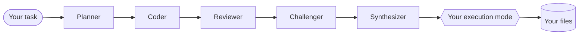
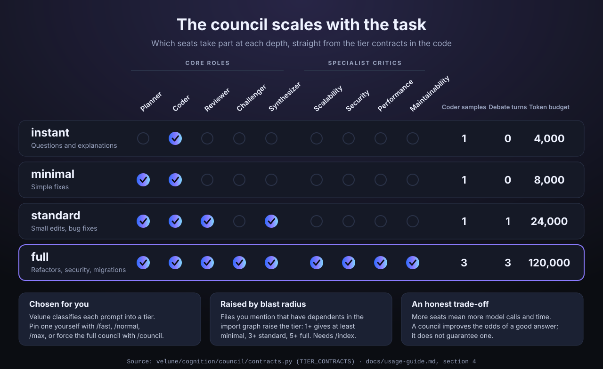
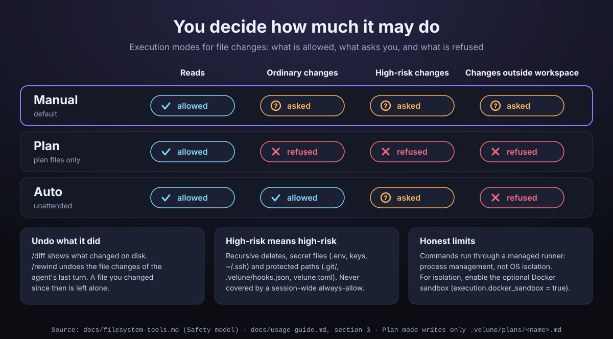

<div align="center">


<h1>Velune CLI</h1>

<h3>AI coding you can trust with a real codebase.<br>Your models. Your machine. Your approval.</h3>

<p>
An open-source, local-first AI engineer for the terminal. For harder tasks a council of agents plans, writes, reviews
and challenges the change, and nothing touches your files until the execution mode <em>you</em> chose allows it.
</p>

<p>
<a href="https://pypi.org/project/velune-cli/"></a>
<a href="https://pypi.org/project/velune-cli/"></a>
<a href="https://github.com/Surya-Hariharan/Velune-CLI/actions/workflows/ci.yml"></a>
<a href="https://github.com/Surya-Hariharan/Velune-CLI/blob/main/LICENSE"></a>
<a href="https://github.com/Surya-Hariharan/Velune-CLI"></a>
</p>

<p>


</p>

<p>
<a href="#the-problem">Problem</a> ·
<a href="#the-solution">Solution</a> ·
<a href="#how-it-works">How it works</a> ·
<a href="#who-its-for">Who it's for</a> ·
<a href="#where-we-are">Where we are</a> ·
<a href="#where-were-going">Vision</a> ·
<a href="#get-started-in-two-minutes">Get started</a>
</p>

</div>

---

## The problem

AI can now write code. Letting it near the codebase that matters is a different decision, and it raises questions that
a demo does not answer: where does my code go, who checks the answer, what is it allowed to change, which model am I
tied to, and does it understand my project or start from nothing every time?

Velune CLI is built around those five questions. Each answer below points at the file or command in this repository
that backs it, so you can check it instead of taking our word for it.

<div align="center">

</div>

## The solution

**Velune CLI is an AI engineer built for trust first and speed second.** It runs in your terminal on your real
repository.

- 🔒 **You choose where your code goes.** Run a model on your own machine, or pick a cloud provider. Velune has no
  analytics service and sends no usage data to its maintainers ([SECURITY.md](https://github.com/Surya-Hariharan/Velune-CLI/blob/main/SECURITY.md#zero-telemetry)).
  A failed local model is not retried on a cloud provider unless you opt in.
- 🧠 **A council, scaled to the task.** Depth is classified per prompt: a question gets a single Coder seat, an ordinary
  edit adds a Planner and a Reviewer, and a refactor or security change convenes up to nine seats, including a
  Challenger and four specialist critics.
- 🛡️ **You set how much it may do.** Manual (the default), Plan and Auto modes, diff preview, path containment,
  git snapshots and one-command undo. High-risk changes are never applied without your approval.
- 📚 **It remembers your project.** Five memory tiers per workspace and an on-demand index of symbols and imports, so a
  change can be judged by what depends on it.

## How it works

1. **Plan.** Describe the change. Velune investigates the repository and writes a plan; in Plan mode no project file
   changes.
2. **Review.** The council checks the work. Depth is chosen for you, raised when the files you touch are widely
   imported, or pinned with `/fast`, `/normal`, `/max` and `/council`.
3. **Approve.** In Manual mode every change is shown as a diff and applied only after you approve it.
4. **Undo.** `/rewind` undoes the agent's last turn and `/undo` reverts its last commit. Plan-driven changes take a git
   snapshot first and are restored if execution fails.



<sub>The full pipeline runs at full depth. Lighter tiers use fewer seats, as the matrix below shows.</sub>

<div align="center">

</div>

<div align="center">

</div>

A council improves the odds of a good answer and does not guarantee one. It costs more model calls and time than a
single model, which is why it only convenes at the depth a task needs. Read diffs before accepting them.

```text
/plan add input validation to signup     investigate and write a plan; no project files change
approve                                  run the plan; each change is shown for approval
/diff                                    review exactly what changed on disk
/rewind                                  undo the agent's last turn if you disagree
```

## Works with what you already use

<div align="center">

</div>

## Who it's for

- **Teams that do not want prompts leaving their own hardware.** Use a local model and the loop stays on your machine.
  Velune sends nothing to its maintainers, and traffic goes only where you direct it.
- **Engineering leaders who want AI changes reviewed before they land.** The council, diff preview and a trace of
  permission decisions (`velune trace --type permission`) turn "trust the model" into a process you can point to.
- **Developers who want a choice of models.** Start with a local model or a free cloud tier, then switch providers
  when you need to.
- **Builders of AI-assisted tooling.** An open, extensible, MCP-native codebase you can read, fork and extend.

## Where we are

Velune is shipping software in public **beta** (0.x). Command names, configuration keys and on-disk formats can change
between minor releases, and `main` can be ahead of the latest PyPI release; the
[changelog](https://github.com/Surya-Hariharan/Velune-CLI/blob/main/CHANGELOG.md) lists what is unreleased.

<div align="center">

</div>

Those figures are not marketing copy: `tests/test_readme_facts.py` recomputes them from the code on every CI run and
fails if a graphic stops matching the repository. The same honesty applies to the limits. Command execution is
process management rather than an OS-level sandbox (a Docker sandbox is available as an opt-in), semantic memory needs
the optional `rag` extra, and the threat model and known limitations are published in
[SECURITY.md](https://github.com/Surya-Hariharan/Velune-CLI/blob/main/SECURITY.md).

## Where we're going

There is no dated roadmap, only the open areas the project's own documentation names:

- **Native orchestration engine.** `velune native` is experimental and read-only. Its documented next steps include
  independent planner and reviewer models and an evaluation strategy.
- **OS-level isolation by default.** Command execution is not sandboxed unless you enable the Docker sandbox.
- **More MCP reach.** The MCP server offers stdio only, and Velune pins `mcp<2.0.0` until its server code is migrated.
- **Verified everywhere.** Intel macOS is unverified, and Linux arm64 and musl Linux are not covered by CI.

## Get started in two minutes

**macOS, Linux, WSL**

```bash
curl -fsSL https://raw.githubusercontent.com/Surya-Hariharan/Velune-CLI/main/scripts/install.sh | sh
```

**Windows (PowerShell)**

```powershell
irm https://raw.githubusercontent.com/Surya-Hariharan/Velune-CLI/main/scripts/install.ps1 | iex
```

Or `pipx install velune-cli` / `uv tool install velune-cli`. The installer needs no existing Python.

<table>
<tr>
<td width="50%" valign="top">

**Fully local (Ollama)**

```bash
ollama pull qwen2.5-coder:7b
cd your-project
velune init
velune
```

</td>
<td width="50%" valign="top">

**With a cloud provider (Groq free tier)**

```bash
cd your-project
velune init --provider groq
velune setup   # asks for your key
velune
```

</td>
</tr>
</table>

Run `velune doctor` at any time to check your setup.

## Work with us

Velune is built by one maintainer and welcomes people who care about trustworthy AI tooling.

- **Try it and tell us what breaks.** [Open an issue](https://github.com/Surya-Hariharan/Velune-CLI/issues/new/choose)
  or start a [discussion](https://github.com/Surya-Hariharan/Velune-CLI/discussions).
- **Contribute.** Add a provider, a command or a council critic; verify a platform; record a demo; improve the docs. The
  [contributing guide](https://github.com/Surya-Hariharan/Velune-CLI/blob/main/CONTRIBUTING.md) has step-by-step
  instructions, and the [wish list](https://github.com/Surya-Hariharan/Velune-CLI/blob/main/docs/reference.md#ways-to-contribute)
  shows what is most wanted.
- **Report a vulnerability** privately through a
  [GitHub security advisory](https://github.com/Surya-Hariharan/Velune-CLI/security/advisories/new), never in a public
  issue.

## Learn more

| | |
| :--- | :--- |
| [Technical reference](https://github.com/Surya-Hariharan/Velune-CLI/blob/main/docs/reference.md) | Installation and platform support, providers, execution modes, memory, MCP, configuration and every command |
| [Usage guide](https://github.com/Surya-Hariharan/Velune-CLI/blob/main/docs/usage-guide.md) | Day-to-day use: models, modes, review, memory, troubleshooting |
| [Slash commands](https://github.com/Surya-Hariharan/Velune-CLI/blob/main/docs/slash-commands.md) | Every REPL command, alias and usage string |
| [Security policy](https://github.com/Surya-Hariharan/Velune-CLI/blob/main/SECURITY.md) | Threat model, limitations, how to report |
| [Development guide](https://github.com/Surya-Hariharan/Velune-CLI/blob/main/docs/development.md) | Architecture, module boundaries, testing, CI |
| [Changelog](https://github.com/Surya-Hariharan/Velune-CLI/blob/main/CHANGELOG.md) · [Project origin](https://github.com/Surya-Hariharan/Velune-CLI/blob/main/docs/project-origin.md) · [Governance](https://github.com/Surya-Hariharan/Velune-CLI/blob/main/GOVERNANCE.md) | Version history, provenance, how decisions are made |

---

<div align="center">

**Velune CLI** is licensed under the [Apache License 2.0](https://github.com/Surya-Hariharan/Velune-CLI/blob/main/LICENSE). Copyright 2026 Surya HA.
Created and maintained by [Surya HA](https://github.com/Surya-Hariharan). Third-party names (for example Ollama, OpenAI,
Anthropic) belong to their owners and are used only to identify services Velune can connect to.
See [NOTICE](https://github.com/Surya-Hariharan/Velune-CLI/blob/main/NOTICE),
[AUTHORS](https://github.com/Surya-Hariharan/Velune-CLI/blob/main/AUTHORS.md) and the
[Code of Conduct](https://github.com/Surya-Hariharan/Velune-CLI/blob/main/CODE_OF_CONDUCT.md).

</div>
