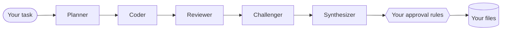

<div align="center">



<h1>Velune CLI</h1>

<h3>AI coding you can trust with a real codebase.<br>Your models. Your machine. Your approval.</h3>

<p>
An open-source, local-first AI engineer for the terminal. A council of agents plans, writes, reviews and challenges every
change, and nothing touches your files until the rules <em>you</em> set allow it.
</p>

<p>
<a href="https://pypi.org/project/velune-cli/"></a>
<a href="https://pypi.org/project/velune-cli/"></a>
<a href="https://github.com/Surya-Hariharan/Velune-CLI/actions/workflows/ci.yml"></a>
<a href="https://github.com/Surya-Hariharan/Velune-CLI/blob/main/LICENSE"></a>
<a href="https://github.com/Surya-Hariharan/Velune-CLI"></a>
</p>

<p>


</p>

<p>
<a href="#the-problem">Problem</a> ·
<a href="#the-solution">Solution</a> ·
<a href="#how-it-works">How it works</a> ·
<a href="#why-velune-wins">Why it wins</a> ·
<a href="#who-its-for">Who it's for</a> ·
<a href="#where-we-are">Traction</a> ·
<a href="#where-were-going">Vision</a> ·
<a href="#get-started-in-two-minutes">Get started</a>
</p>

</div>

---

## The problem

AI can now write code. Teams still hesitate to let it near the codebase that matters, and they are right to.

| What teams run into | Why it blocks adoption |
| :--- | :--- |
| **Your source code leaves the building.** | Most AI assistants send prompts and repository context to one vendor's cloud. For proprietary, regulated or client code, that is a non-starter. |
| **One model, one shot, no second opinion.** | A single model answers once and sounds confident whether it is right or not. The review burden lands on a human, on every change. |
| **Agents that act first and explain later.** | An assistant that can edit files and run commands, with no clear limits, is a risk to the repository, the machine and your secrets. |
| **Vendor lock-in.** | Workflows, prompts and habits are tied to a single provider's pricing, outages and policy changes. |
| **No memory of your project.** | Every session starts cold, so the assistant keeps relearning your structure, conventions and past decisions. |

The result: AI coding tools that are impressive in a demo and hard to trust in production.

## The solution

**Velune CLI is an AI engineer built for trust first and speed second.** It runs in your terminal, works on your real
repository, and is designed around the four things teams actually ask for:

- 🔒 **Control over where your code goes.** Run models entirely on your own machine, or pick a cloud provider you choose.
  Velune has no analytics service and sends no usage data to its maintainers. A failed local model is never silently
  retried on a cloud provider unless you opt in.
- 🧠 **A council, not a lone model.** For hard tasks, five agents (Planner, Coder, Reviewer, Challenger, Synthesizer)
  plan, write, review and *argue with* the work before you see it. Simple questions skip the council, so you only pay
  for depth when a task needs it.
- 🛡️ **You set how much it may do.** Manual, Plan and Auto execution modes; diff preview before every change; path
  containment; git snapshots; one-command undo. Risky operations always ask first, in every mode.
- 📚 **It remembers your project.** Five tiers of per-workspace memory, plus an on-demand index of your symbols and
  import graph, so it understands what a change will affect before it makes one.

## How it works



1. **Plan.** Describe the change. Velune investigates the repository and writes a plan. In Plan mode no project file is
   touched.
2. **Review.** The council checks the work from several angles. How many agents run is chosen per task, or pinned with
   `/fast`, `/normal` and `/max`.
3. **Approve.** Every change is shown as a diff and applied only after you approve it (or within the limits you set).
4. **Undo.** `/rewind` undoes the agent's last turn. `/undo` reverts its last commit. Plan-driven changes take a git
   snapshot first and are restored if execution fails.

```text
/plan add input validation to signup     investigate and write a plan; no project files change
approve                                  run the plan; each change is shown for approval
/diff                                    review exactly what changed on disk
/rewind                                  undo the agent's last turn if you disagree
```

A council improves the odds of a good answer and does not guarantee one. It costs more calls and time than a single
model, which is why it only convenes when a task warrants it. Read diffs before accepting them.

## Why Velune wins

| | Typical AI coding assistant | **Velune CLI** |
| :--- | :--- | :--- |
| **Where your code goes** | One vendor's cloud | **Your machine, or a provider you choose** |
| **Who checks the answer** | One model, once | **A council of five agents that review and challenge** |
| **Permission to change files** | Often implicit | **Explicit modes, diff preview, snapshots, undo** |
| **Model choice** | Locked to one provider | **18 provider adapters, local and cloud** |
| **Knowledge of your repo** | Starts cold each session | **Persistent memory and a symbol and import index** |
| **Telemetry** | Usually on | **None. No analytics service** |
| **Integrations** | Closed | **MCP in both directions, plugins, hooks, custom commands** |
| **Source and license** | Closed | **Open source, Apache-2.0** |

**Built for the enterprise instinct, available to everyone.** Velune speaks the Model Context Protocol both ways:
editors can call Velune's tools, and Velune can use external MCP servers. Docker and database connectors (PostgreSQL,
MySQL / MariaDB, Supabase) are built in as opt-in integrations, with read-only query defaults and approval for changes.

## Who it's for

- **Teams with code they cannot send to a third party.** Regulated industries, client work, internal tools, anything
  under NDA. Run a local model and keep the whole loop on your hardware.
- **Engineering leaders who want AI output reviewed before it lands.** The council, diff preview and audit trail
  (`velune trace`) turn "trust the model" into a process you can point to.
- **Developers who want freedom of choice.** Start free with a local model or a free cloud tier, move to a stronger
  model later, and change your mind again without rewriting your workflow.
- **Builders of AI-assisted tooling.** An open, extensible, MCP-native foundation you can read, fork and extend.

## Where we are

Velune is real, shipping software, in public **beta** (version 0.9.9).

| | |
| :--- | :--- |
| **Published** | On PyPI as [`velune-cli`](https://pypi.org/project/velune-cli/), with one-line installers for Windows, macOS and Linux |
| **Engineered** | Typed and tested; CI runs the suite on **3 operating systems × 5 Python versions** (3.10 to 3.14) on every change |
| **Broad** | **18 provider adapters**, **55 slash commands**, a five-tier memory system, MCP client and server |
| **Safe by design** | Permission rules are enforced in the tool layer, not by asking the model nicely; the threat model and known limits are published in [SECURITY.md](https://github.com/Surya-Hariharan/Velune-CLI/blob/main/SECURITY.md) |
| **Open** | Apache-2.0, a public changelog, public governance, and a private channel for security reports |

We would rather be precise than impressive: this is beta software, command names and config keys can still change
between minor releases, and command execution is process management rather than an OS-level sandbox (a Docker sandbox
is available as an opt-in for real isolation). The [project status](https://github.com/Surya-Hariharan/Velune-CLI/blob/main/docs/reference.md#project-status-security-and-license)
section says exactly where the lines are.

## Where we're going

There is no dated roadmap, only honest open areas taken from the project's own documentation:

- **Native orchestration engine.** An experimental, read-only engine (`velune native`) is the foundation for independent
  planner and reviewer models and a proper evaluation strategy.
- **Stronger isolation by default.** Command execution is not sandboxed unless you enable the Docker sandbox. Making
  OS-level isolation the default is the largest open trust gap.
- **More ways in.** MCP server transports beyond stdio, and migration to the next MCP SDK major version.
- **Verified everywhere.** Intel macOS, Linux arm64 and Alpine are not yet covered by CI.

## Get started in two minutes

**macOS, Linux, WSL**

```bash
curl -fsSL https://raw.githubusercontent.com/Surya-Hariharan/Velune-CLI/main/scripts/install.sh | sh
```

**Windows (PowerShell)**

```powershell
irm https://raw.githubusercontent.com/Surya-Hariharan/Velune-CLI/main/scripts/install.ps1 | iex
```

Or `pipx install velune-cli` / `uv tool install velune-cli`. The installer needs no existing Python.

<table>
<tr>
<td width="50%" valign="top">

**Fully local (Ollama)**

```bash
ollama pull qwen2.5-coder:7b
cd your-project
velune init
velune
```

</td>
<td width="50%" valign="top">

**With a cloud provider (Groq free tier)**

```bash
cd your-project
velune init --provider groq
velune setup   # asks for your key
velune
```

</td>
</tr>
</table>

Run `velune doctor` at any time to check your setup.

## Work with us

Velune is built by one maintainer and is looking for people who care about trustworthy AI tooling.

- **Try it and tell us what breaks.** Early-adopter feedback is the most valuable thing right now.
  [Open an issue](https://github.com/Surya-Hariharan/Velune-CLI/issues/new/choose) or start a
  [discussion](https://github.com/Surya-Hariharan/Velune-CLI/discussions).
- **Pilot it with your team.** If you have a use case where code must stay on your own infrastructure, we want to hear
  about it. Start a [discussion](https://github.com/Surya-Hariharan/Velune-CLI/discussions) and describe the constraint.
- **Contribute.** Add a provider, a command or a council critic; verify a platform; record a demo; improve the docs. The
  [contributing guide](https://github.com/Surya-Hariharan/Velune-CLI/blob/main/CONTRIBUTING.md) has step-by-step instructions, and a public
  [wish list](https://github.com/Surya-Hariharan/Velune-CLI/blob/main/docs/reference.md#ways-to-contribute).
- **Report a vulnerability** privately through a
  [GitHub security advisory](https://github.com/Surya-Hariharan/Velune-CLI/security/advisories/new), never in a public
  issue.

## Learn more

| | |
| :--- | :--- |
| [Technical reference](https://github.com/Surya-Hariharan/Velune-CLI/blob/main/docs/reference.md) | Installation and platform support, providers, execution modes, memory, MCP, configuration and every command |
| [Usage guide](https://github.com/Surya-Hariharan/Velune-CLI/blob/main/docs/usage-guide.md) | Day-to-day use: models, modes, review, memory, troubleshooting |
| [Security policy](https://github.com/Surya-Hariharan/Velune-CLI/blob/main/SECURITY.md) | Threat model, limitations, how to report |
| [Development guide](https://github.com/Surya-Hariharan/Velune-CLI/blob/main/docs/development.md) | Architecture, module boundaries, testing, CI |
| [Changelog](https://github.com/Surya-Hariharan/Velune-CLI/blob/main/CHANGELOG.md) · [Project origin](https://github.com/Surya-Hariharan/Velune-CLI/blob/main/docs/project-origin.md) · [Governance](https://github.com/Surya-Hariharan/Velune-CLI/blob/main/GOVERNANCE.md) | Version history, provenance, how decisions are made |

---

<div align="center">

**Velune CLI** is licensed under the [Apache License 2.0](https://github.com/Surya-Hariharan/Velune-CLI/blob/main/LICENSE). Copyright 2026 Surya HA.
Created and maintained by [Surya HA](https://github.com/Surya-Hariharan). Third-party names (for example Ollama, OpenAI,
Anthropic) belong to their owners and are used only to identify services Velune can connect to.
See [NOTICE](https://github.com/Surya-Hariharan/Velune-CLI/blob/main/NOTICE), [AUTHORS](https://github.com/Surya-Hariharan/Velune-CLI/blob/main/AUTHORS.md) and the [Code of Conduct](https://github.com/Surya-Hariharan/Velune-CLI/blob/main/CODE_OF_CONDUCT.md).

</div>
