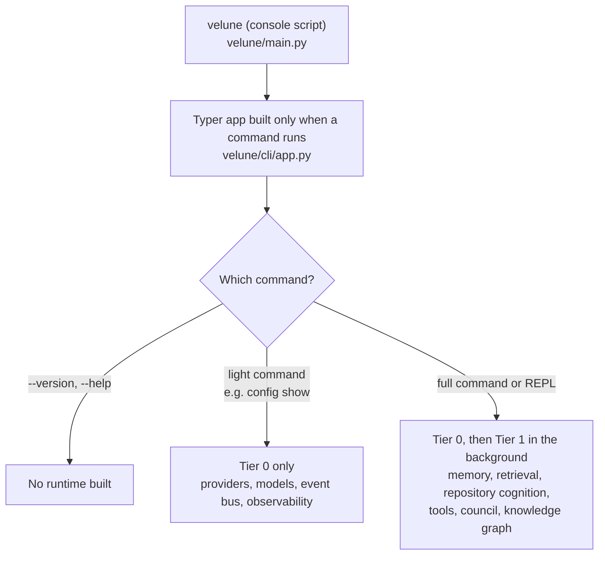

# Development Guide

*How the codebase is put together at the framework level, how CI validates it, and how to reason about
changes that cross subsystem boundaries.*

For "how do I set up a venv and open a PR," see [CONTRIBUTING.md](../CONTRIBUTING.md). That document owns
the step-by-step contributor workflow; this one owns the *why* behind the structure so those steps make
sense.

**How to read this guide.** If you are new to the codebase, read sections 1 and 2 first: they explain how
the process starts up and which packages depend on which. Section 3 covers testing conventions and
section 4 covers what CI checks, so you know what must pass before a pull request can merge. Sections 5 to
7 are reference material to come back to when you add an extension or chase a bug.

---

## Contents

- [1. The bootstrap / DI layer](#1-the-bootstrap--di-layer)
- [2. Module boundaries — what depends on what](#2-module-boundaries--what-depends-on-what)
- [3. Testing](#3-testing)
- [4. CI pipeline](#4-ci-pipeline)
- [5. Extension points — the design pattern behind all of them](#5-extension-points--the-design-pattern-behind-all-of-them)
- [6. Debugging tips specific to this codebase](#6-debugging-tips-specific-to-this-codebase)
- [7. Where things live, cross-referenced](#7-where-things-live-cross-referenced)

---

## 1. The bootstrap / DI layer

Everything in Velune CLI beyond the Typer command dispatch runs on top of a small dependency-injection
kernel in `velune/kernel/`:

- **`ServiceContainer`** (`kernel/registry.py`) — a registry of named services (`runtime.<name>` keys)
  with lazy factories, concrete instances (`register_instance`), hot-swapping (`hot_swap`) and readiness
  gates (`mark_ready`, `await wait_ready(key, timeout)`) for services that finish loading in the
  background.
- **`RuntimeEnvironment`** (`kernel/bootstrap.py`) — what every subsystem factory receives: workspace
  path, config, the container and the lifecycle coordinator.
- **`SubsystemModule`** (`kernel/bootstrap.py`) — the unit of registration:
  `SubsystemModule(name, factory, container_key, lifecycle_key=None, dependencies=[], tier=1)`. Each major
  package exposes its modules in a **`subsystems.py`** file (`PROVIDER_MODULES`, `MEMORY_MODULES`,
  `TOOL_MODULES`, …); `RuntimeBootstrapper` topologically sorts them by `dependencies` and wires them in.
  - A module with a `lifecycle_key` is lifecycle-critical: its `initialize()`/`shutdown()` are driven by
    `LifecycleCoordinator`, and a factory failure aborts startup. A module without one is optional — a
    failure is logged and the module skipped. A factory that returns `None` is treated as "not provided".
  - **`tier`** — `0` runs synchronously and must be cheap (it delays the first prompt: providers, models,
    the event bus, observability); `1` is background warm-up after the prompt is interactive (memory,
    retrieval, repository cognition, tools, the council, the knowledge graph, the intelligence engine).
    Tier-1 imports are deferred in `kernel/modules.py:load_background_modules()` so heavy package imports
    never run on the startup path.
- **CLI bootstrap levels** — independently of subsystem tiers, `velune/cli/registry.py:CommandSpec.
  bootstrap` is `"light"` (Tier 0 only — e.g. `velune config show`) or `"full"` (Tier 0 and Tier 1).
  `velune --version` and `--help` never build a runtime at all.

The startup sequence, in short:



**Practical implication:** if you add a subsystem, give it a factory in its package's `subsystems.py` and
register the module list with the bootstrapper, rather than instantiating it inline where it is used.
Reach services through the container you were handed (`repl.container`, `cli_context.container`,
`env.container`) — the process-wide `get_container()` is a *separate* instance that the runtime does
**not** populate, so code that looks services up there silently gets nothing in a real session.

---

## 2. Module boundaries — what depends on what

There is no enforced layering; this is the *intended* direction (higher layers depend on lower ones):

```text
cli/            ← REPL, commands, rendering — depends on almost everything below
cognition/      ← the Reasoning Council — depends on providers, memory, models, execution
orchestration/  ← native tool loop (+ an alias of the council orchestrator)
retrieval/      ← hybrid search — depends on repository/knowledge data and the memory stores
memory/         ← tiered conversational memory — depends on core/kernel
intelligence/   ← change detection → incremental reindex; drives knowledge/
repository/ knowledge/  ← indexing, import graph, knowledge graph
tools/          ← file / git / exec / web primitives — depends on execution, core
execution/      ← sandboxing, command validation, diff preview
providers/ models/  ← model adapters, credentials, discovery, capability scoring
mcp/            ← MCP client + server — exposes the tool registry
hooks/ plugins/ resources/ integrations/  ← extension points
kernel/ core/   ← DI, config, paths, trust, retry, task registry, errors
```

In practice a few packages reach "upward" — `cognition/`, `context/` and `proactive/` import helpers from
`cli/` — so treat the diagram as a guide, not a guarantee, and prefer not to add new upward imports.
Subsystems used headlessly (for example `velune mcp serve`, which has no REPL) should not import `cli/`.

`recovery/` (backup/restore) sits beside `core/` as a cross-cutting concern; `observability/`, `telemetry/`
and `proactive/` observe the rest of the system via the event bus (`velune/events.py`).

---

## 3. Testing

Tests live in `tests/` (one module per concern) and `tests/integration/` (cross-subsystem). There is no
`tests/unit` directory.

Conventions worth knowing before adding tests:

- **Prefer real objects over mocks for storage.** A passing mocked store has hidden real integration bugs
  before. Where a real SQLite/LanceDB/Qdrant instance is cheap in-process, use it (`tmp_path`).
- **Test wiring, not just classes.** A feature wired into the REPL should have a test that goes through the
  registry (`build_slash_registry()` in `velune/cli/slash_dispatcher.py`) or the actual dispatch — a handler
  that is implemented but never registered has been a recurring bug.
- **Dead-code check:** before extending a class, grep for its importers. If nothing outside the file and its
  own tests imports it, it is probably superseded — flag it rather than building on it.
- **Isolate config.** Config and the default provider are discovered by walking up from the working
  directory for a `velune.toml`; run tests from a temp dir (`monkeypatch.chdir(tmp_path)`) and never leave a
  stray `velune.toml` in a parent folder.
- **Agent tests go through the loop.** A tool the agent uses should be tested via the production
  registry (`tests/_fs_registry.py::production_registry`), the permission gate and `ToolLoopRunner` with a
  scripted model, asserting on the files on disk — see `tests/test_agent_filesystem_e2e.py` and
  [Filesystem tools](filesystem-tools.md#adding-a-filesystem-tool).
- **Doc tests:** `tests/test_slash_commands_doc.py` fails when `docs/slash-commands.md` drifts from the
  registered commands, and `tests/test_docs_links.py` fails on a broken relative link in the Markdown docs.
- **Integration tests go through the gate.** Test resource and MCP behaviour with the production
  `ResourceManager`, a real `PermissionGate` and, for the loop, `ToolLoopRunner` with a scripted provider;
  assert on what ran, on the audit record and on the redacted result. Tests that start real processes
  (`tests/test_process_supervision.py`) must not leave any behind.

Run the same checks CI does:

```bash
pytest                              # full suite (CI runs plain `pytest`)
pytest -k provider -q               # a slice
pytest --cov=velune --cov-report=term-missing -q   # coverage
ruff check velune/                  # lint (blocking)
ruff format --check velune/         # format (blocking)
pyright velune/                     # type check (blocking)
```

> `pyright`, not `mypy`, is the type checker CI gates on. `[tool.pyright]` in `pyproject.toml` runs in
> `basic` mode — it catches structural mistakes, not full strict typing. Lint and type checks cover
> `velune/` only, not `tests/`.

> **Windows:** the sandbox refuses executables that resolve outside trusted locations (system roots, the
> running interpreter's environment, a `.venv`/`venv` directly under the workspace). If sandbox/process
> tests fail locally with "resolved to untrusted path", put your virtualenv's `Scripts` directory first on
> `PATH`.

---

## 4. CI pipeline

`.github/workflows/ci.yml` runs on every push/PR to `main` or `develop`, gated by a final `CI Pass`
aggregation job:

| Job | What it does |
| --- | --- |
| **Lint** | `ruff check velune/`, `ruff format --check velune/`, `pyright velune/` — all blocking |
| **Security** | `pip-audit --skip-editable`; `uv lock --check` (the committed `uv.lock` must match `pyproject.toml`); `bandit` (medium+ severity/confidence gates the build, plus a low-severity count baseline that may not grow); a gitleaks secret scan; regression guards: no `shell=True` in `velune/`, `create_subprocess_shell` only at allow-listed sites, and no new `asyncio.run()` call sites |
| **Tests** | `pip install -e ".[all,dev]"` then `pytest`, across Python 3.10–3.14 × Ubuntu / Windows / macOS |
| **Build & Validate Artifacts** | Hatchling sdist + wheel (reproducible via `SOURCE_DATE_EPOCH`), `twine check --strict`, and the wheel must be pure-Python (`py3-none-any`) |
| **Wheel Install + REPL Smoke** | installs the built wheel into a clean environment and runs `velune --version`, `velune --help`, `python -m velune --version`, `velune <doctor|config|provider|models> --help` (strict), and `velune doctor` / `velune doctor --json` (strict: they fail only on a *core* installation problem) across OS × Python |
| **Lowest Dependency Versions** | installs the *lowest* version allowed by every `pyproject.toml` floor, **wheels only** (`uv pip install --no-build --resolution lowest-direct`), then runs the smoke test and `pytest -m "not integration"` on Python 3.10 and 3.14 × all three OSes, plus two jobs that also install the `[rag,parsing]` extras at their floors. It fails if a floor is too old for the code, or if it has no prebuilt wheel for some Python/OS (which would make a user's `pip install` compile from source) |
| **Install Over Stale Dependencies** | pre-installs old, incompatible versions of core deps (as another tool in a shared environment would), installs the wheel on top, and asserts pip upgraded them and Velune starts |
| **One-line Installer** | runs `scripts/install.sh` (Linux/macOS, plus `shellcheck`) and `scripts/install.ps1` (Windows) on clean runners against the built wheel |
| **CI Pass** | fails if any of the above failed — the single required status check |

`.github/workflows` defines no CodeQL workflow; any code-scanning configured on GitHub itself is outside
this repository. `.github/workflows/release.yml` handles publishing (tag-triggered; it verifies the
tag matches the package version, builds, publishes to PyPI and creates the GitHub release) — read that file
for the exact steps.

**Invariant:** the PyPI wheel stays pure-Python (`py3-none-any`); the repository contains no Go or Rust code,
so don't add a compiled dependency to a path that must work after a bare `pip install velune-cli`.

**Dependency floors are tested, not guessed.** Each core floor in `pyproject.toml` is the oldest release that
the suite passes against *and* that ships a wheel for every supported Python/OS. Compiled packages (`numpy`,
`tiktoken`, `pydantic`) therefore have per-Python floors via environment markers. If a floor is too low, pip
leaves a stale copy from another tool in place and Velune breaks at runtime (e.g. `typer<0.16` +
`click>=8.2` crashes every `--help`), or pip picks a version with no wheel and tries to compile it. When you
raise a floor or add a dependency, the **Lowest Dependency Versions** job proves it. Don't declare a
dependency that `velune/` never imports: `openai`, `anthropic` and `orjson` used to be listed but were never
imported (providers use plain `httpx`), and they only added install surface. `velune doctor`'s *Core
Dependencies* check reads the installed package metadata (evaluated with `packaging`, which is a core
dependency for that reason), so it always matches `pyproject.toml`.

**`velune doctor` contract.**
- A bare `velune doctor` runs the diagnostics; `doctor check` is the same thing.
- It shows an environment summary (version, interpreter, OS/arch, install, config and data locations).
- It ends with a *core* verdict. Checks in `CORE_CHECKS` (`velune/cli/commands/doctor.py`) decide the
  exit code: Python version, launcher, Scripts on PATH, pip, core dependencies, data dirs, SQLite.
- Everything else is an optional integration. It is reported but never makes the exit code non-zero.
  A missing extra is a `warn` with an install hint, never a `fail`.
- Doctor never writes to the current directory; probes use self-cleaning temp files in Velune's own data
  and config dirs. Keep all of this true when adding checks.

> Dependency versions are pinned in the committed `uv.lock` (check with `uv lock --check`; refresh with
> `uv lock --upgrade-package <name>`). `[project.optional-dependencies]` defines `rag`, `parsing`,
> `telemetry`, `git`, `gguf`, `docker`, `all`, and `dev`.

---

## 5. Extension points — the design pattern behind all of them

Hooks, plugins, file-based slash commands, and MCP server declarations share one shape: **declarative
configuration loaded into an existing registry**, rather than a new mechanism per feature.

- A slash command, a hook binding and an MCP server are all data (TOML/JSON/Markdown) describing *what* to
  run and *when*, not code executed in Velune's own interpreter.
- They load into the same objects the built-ins use (`SlashCommandRegistry`, `HookDispatcher`,
  `MCPServerRegistry`), so a plugin-provided command gets tab-completion, palette search and `/help` for
  free.
- Loading happens at REPL startup (`PluginManager`, `FileCommandLoader`, `MCPServerRegistry`), so a broken
  manifest fails loudly at startup.

Where each one lives:

| Extension | Config | Code |
| --- | --- | --- |
| Slash commands (TOML) | `~/.velune/commands/`, `<workspace>/.velune/commands/` | `cli/commands/file_commands.py` |
| Plugins | `<workspace>/.velune/plugins/<name>/` and `~/.velune/plugins/<name>/`, each with `.velune-plugin/plugin.json` (+ `commands/`, `skills/`, `hooks/hooks.json`, `.mcp.json`) | `plugins/` |
| Hooks | `<workspace>/.velune/hooks.json`, `~/.velune/hooks.json`, `velune.toml [hooks]` | `hooks/` |
| MCP servers | `.mcp.json`, `~/.mcp.json`, `velune.toml [mcp.servers]` — see [mcp.md](mcp.md) | `mcp/` |
| Resource connectors | `velune.toml [resources.*]` | `resources/` |

Prefer extending one of these registries over inventing a new loading mechanism.

### Resource connectors and the authorization pipeline

`velune/resources/` connects Velune to applications on the developer's machine (Docker through the Docker SDK — see [docker.md](docker.md) —
local PostgreSQL and MySQL, Supabase, background processes, and HTTP APIs — see [http.md](http.md)). A connector is one `ResourceConnector` subclass (`resources/base.py`) registered with
`ResourceManager.register`; nothing else needs to change.

**What a connector declares.** `capabilities()` lists each action with a permission tier
(`READ`/`WRITE`/`EXECUTE`/`ADMIN`), a `destructive` flag and a dotted `scope` (`docker.container.start`; empty
means `<resource_id>.<action>`). `lifecycle` says how the manager treats the session (`STATELESS`,
`PERSISTENT`, `POOL`, `SESSION`, `SUPERVISED_PROCESS`); the manager owns connect, reuse, health and
disconnect, serialised per resource. Operational failures are returned as a `ResourceResult` with a normalized
`ErrorCode`, never raised, and never contain credentials.

**How a call is authorized.** There is one decision point, the same one every native tool uses:

```
ResourceManager.execute ─▶ ResourceOperationTool ─▶ authorize_and_execute ─▶ PermissionGate ─▶ connector.execute
   (resources/manager.py)    (resources/bridge.py)     (tools/base/tool.py)     (permissions/)
```

The connector only *describes* the call. `describe_actions()` returns `Action`s of type `INTEGRATION_READ`,
`_WRITE`, `_EXECUTE` or `_DELETE` (`permissions/actions.py`), each with its scope and a risk. An override may
add context or raise the risk, never lower it: the bridge always includes the framework's own classification
too. The policy (`permissions/policy.py`) then decides by execution mode:

| Action | Manual | Plan | Plan, executing an approved plan | Auto |
| --- | --- | --- | --- | --- |
| `INTEGRATION_READ` | allow | allow | allow | allow |
| `_WRITE` / `_EXECUTE`, medium risk | ask | refuse | ask | allow |
| High risk, or `INTEGRATION_DELETE` | ask | refuse | ask | ask |
| A change outside the workspace (a read there asks in every mode) | ask | refuse | ask | refuse |
| No valid scope, or `blocked` | refuse | refuse | refuse | refuse |

High-risk actions are never covered by an "always allow" grant. Scopes are matched exactly; there are no
wildcards. The REPL supplies the session gate through `make_resource_context_factory`
(`cli/handlers/resources.py`), so `/resource`, the agent and MCP share one mode, one set of grants and one audit
trail. A legacy `ResourceManager(approver=...)` callback still works: it becomes the *ask* callback of a
Manual-mode gate and is consulted only when the policy says a person must decide.

**External MCP tools** take the same path. `ToolLoopRunner` wraps each one in `MCPRegistryTool`
(`mcp/authorization.py`), described as `INTEGRATION_EXECUTE` in the scope `mcp.<server>.<tool>`. A server's
annotations only raise risk (`destructiveHint` makes it `INTEGRATION_DELETE`); `readOnlyHint` is ignored.

**Ownership.** `OwnershipLedger` (`resources/ownership.py`) records what *this session* created. A connector
consults it in `describe_actions` and raises the risk of acting on anything else; a resource that existed
before, or whose origin is unknown, is never assumed to be the task's own. `ownership_effects()` reports what a
successful call created or removed. The CLI-based Docker connector has no action that creates a container, so
starting, stopping or restarting an existing container always needs confirmation today. `compose_up` inspects
the compose file (`resources/docker/compose_scan.py`) and treats a privileged container, host network or
namespaces, a host bind mount, the Docker socket, a device, or anything it cannot inspect as high-risk.

**Secrets.** Store connector credentials with `resources/secrets.py` (the existing encrypted store). Loading a
config registers its secret values with `core/redaction.py`, and `_finish` in the manager passes every result
through `redact_structure`. Never put a credential in an error message, a preview or a log line, and never ask
the model for one.

**Background processes.** `ExecuteCommand(background=True)` registers a `JobRecord` that carries the process
id (with its creation time), the command, a bounded live `ProcessLog` and the exit code. A background job runs
until it is stopped, not for the foreground 30 seconds, under the same sandbox limits as any command.
`execution/processes.py` provides `wait_until_ready` (a log pattern and/or a *loopback-only* port),
`terminate_job` (kills the whole tree; leaves a finished job untouched, because process ids are reused) and
`cleanup_background_jobs`, which the REPL runs on exit. The `process`
integration below exposes them to the model.

### Capability discovery and dynamic tool exposure

The model does not get every integration operation up front. It starts with two discovery tools and asks for
what it needs; the operations it enables appear on its **next** turn. This is built on the resource framework
above and adds no execution path and no permission of its own.

```
turn N    model ── integrations_enable(integration="docker") ──▶ IntegrationToolSource.enable
                                                                    └─▶ CapabilityScope  (version + 1)
after the batch   ToolLoopRunner sees dynamic_tools.version changed ─▶ rebuilds the tool definitions
turn N+1  model receives docker__ps, docker__stop, … ── calls one ──▶ authorize_and_execute ─▶ PermissionGate
                                                                          └─▶ ResourceManager.run_authorized
```

| Piece | Where | Role |
| --- | --- | --- |
| Manifest | `resources/capabilities.py` (`IntegrationManifest`, `OperationManifest`, `build_manifest`) | An immutable, validated snapshot **derived from the connector's own `capabilities()`**, so there is one source of truth. A connector that declares something unsafe (bad id, duplicate or badly named operation, invalid scope, unsupported parameter type) gets a `ManifestError`, is reported as `invalid` and is never exposed. |
| Catalog | `CapabilityCatalog` | Manifests plus **availability**: `connected`, `available`, `unavailable` (the Docker daemon is not running, not merely absent), `needs_configuration`, `invalid`. Probes are bounded and cached for 30 seconds; an open connection is reported from live status; a failed call marks the integration unavailable at once. It also *suggests* integrations for the task by whole-word keyword matching and workspace hints (a compose file suggests `docker`). Suggestions only highlight; they never expose anything. |
| Scope | `CapabilityScope` | Which integrations (and categories) the model currently has. It is per session, re-validated at the start of every run, and has a tool budget. |
| Tools | `resources/tools.py` | `integrations_list`, `integrations_enable`, `integrations_disable`, one `ModelOperationTool` per enabled operation, and the `integration_call` dispatcher. |
| Loop hook | `DynamicToolSource` in `orchestration/tool_loop.py` | After each batch of tool calls the loop compares the source's `version`; if it changed it rebuilds the definitions for the next request. Nothing is mutated inside a turn. |

**Naming.** An operation's tool is `<integration>__<operation>` (`docker__stop`). An integration id never contains
`__`, so the split is unambiguous and two integrations cannot collide on a tool name.

**Budget and fallback.** `resources.max_exposed_tools` (default 24) bounds the operation tools shown at once,
counting the dispatcher. When more are enabled, the overflow stays reachable through `integration_call`, which the
loop authorizes **as the target operation** (`resolve_call`): the gate, the approver, the audit record and any
session "always allow" all see the real tool name and scope, never `integration_call`. Nothing is silently dropped.
`resources.expose_to_model = false` removes every integration tool from the model; `/resource` is unaffected.

**What discovery is not.** A discovered capability is not an authorized capability:

- The discovery tools are READ actions in the policy, so they work in every mode, and enabling changes only what
  the model is *shown*. Every call still goes through `authorize_and_execute` and the gate, and is decided exactly
  as if it had been made directly (`tests/test_dynamic_tool_loop.py` asserts the same verdict for every mode and
  operation through both paths).
- A tool that is not enabled has no route: a hand-built call to it is an "unknown tool" error, with a hint to enable
  it. The dispatcher refuses anything outside the enabled set, including categories the model did not enable.
- Arguments are validated strictly against the exposed schema (unknown names, wrong types, enum and range
  violations are rejected before anything runs; messages name the argument, never its value). The schema the model
  sees is a whitelisted, flat subset; connector credentials and configuration never appear in a description,
  schema or discovery row.
- If a connector is redefined after its operations were exposed, a scope or tier mismatch is refused at call time.
- A result is normalized JSON, redacted, and compacted to stay valid JSON when large (lists keep their leading
  items and the true total; log output keeps the latest lines).
- MCP tools are not part of this discovery: they are offered as before and authorized as described in
  [mcp.md](mcp.md#tool-call-authorization-execution-mode-level).

**Background processes.** The `process` integration (registered when the REPL has a job registry) lets the model
read `status` and `logs`, `wait_ready` and `stop` for background commands **it started**. Only shell jobs the agent
owns exist as far as it can tell, jobs are addressed by job id (a pid is never shown or accepted), a readiness
check takes literal text rather than a regular expression and can only probe a loopback port, and `stop` goes
through the process-identity protections described above.

**Provider compatibility.** Every adapter receives a complete tool list on every request, so a changing set needs no
provider-specific feature. Schemas stay in the portable subset (`type`, `description`, `enum`, `items`,
`required`), and the Gemini translator omits `parameters` for a function with none. The tests translate the real
definitions through the Anthropic, Gemini, Cohere and OpenAI-format paths (which Groq, OpenRouter, Ollama and LM
Studio use) **offline**; no live provider was called, so acceptance by each provider is not verified, and the
providers' own tool-count limits are not asserted. A changed tool list also invalidates a provider's prompt cache
for the prefix that follows it, which is why tools keep a stable, append-only order.

**Adding an integration.** Nothing here needs to change. Subclass `ResourceConnector`, give it a `description` and
`keywords`, and declare each operation with a `scope`, a `category` and a flat `params` schema; implement
`configuration_problem()` (what the user must configure, with no secrets in the text) and `probe_availability()`
(is the application there right now). The manifest, the discovery tools, the schemas and the gate integration
follow from that.

The shipped integrations are Docker (through the Docker CLI), local PostgreSQL and MySQL, Supabase, and
`process`. The example below is **illustrative**, not implemented:

```python
class RedisConnector(ResourceConnector):          # illustrative: there is no Redis connector yet
    resource_id = "redis"
    description = "A local Redis server: read and write keys."
    keywords = ("redis", "cache", "key")

    def capabilities(self):
        key = {"type": "string", "description": "Key name."}
        return [
            ResourceCapability("get", ResourcePermission.READ, "Read a key",
                               scope="redis.key.read", category="inspect",
                               params={"properties": {"key": key}, "required": ["key"]}),
            ResourceCapability("set", ResourcePermission.WRITE, "Write a key",
                               scope="redis.key.write", category="change",
                               params={"properties": {"key": key, "value": {"type": "string"}},
                                       "required": ["key", "value"]}),
        ]
```

The HTTP integration (`resources/http/`, documented in [http.md](http.md)) is a connector of exactly this shape:
`http__request` is declared `READ` with scope `http.request.read` and is *escalated per call* by
`effective_permission` / `describe_actions` (method, destination, environment, path), the way the SQL `query`
action is. What it adds beyond the Docker and database connectors:

- `netpolicy.py` (strict URL parsing, address classes, trusted origins) and `transport.py` (an httpcore backend
  that resolves a name once, validates the answer and connects to it — the DNS-rebinding guard, shared with
  `web_fetch`);
- `client.py` (the executor: manual, re-validated redirects, streamed size caps, bounded decompression, error
  normalization), `present.py` (structured, redacted results) and `assertions.py` (a deterministic engine);
- `auth.py` / `environments.py` (origin-bound credentials in the existing keystore; `{{variables}}`),
  `collections.py` and `openapi.py`.

A connector may add a network-destination `NETWORK` action next to its `INTEGRATION_*` actions (the bridge
accepts exactly that combination); anything else unscoped is still refused. A connector whose failures are about
the *target* rather than the connector (an HTTP client whose API is down) sets
`failures_mark_unavailable = False` so a refused connection does not mark the integration unavailable.

**Testing the HTTP integration.** `tests/http_server.py` is a real local HTTP/1.1 server (with an optional
throw-away TLS certificate); `tests/http_env.py` builds a connector, decides a call exactly as the bridge
describes it, and wires the production manager, gate and tool source. DNS is injected (`resolver=`), so tests
cover rebinding without a network. Run `python -m pytest tests/test_http_*.py tests/test_web_fetch_pinning.py`.

To add a connector: subclass `ResourceConnector`, give every capability a scope, override `describe_actions`
only to add risk, return `ResourceResult` with an `ErrorCode`, load secrets through `resources/secrets.py`,
and test it through the manager with a real `PermissionGate` as in `tests/test_resource_authorization.py` and
`tests/test_docker_compose_authorization.py`.

**Trust matters for extensions.** Project-level hooks (`.velune/hooks.json` and `velune.toml [hooks]`) and
project `.mcp.json` servers load only for directories the user has trusted (`velune/core/trust.py`).
User-level files under `~/.velune/` are always loaded. When you add a new extension source that can run
commands or change where credentials are sent, put it behind the same trust check, and read
[SECURITY.md](../SECURITY.md#network-and-mcp-security) first. TOML slash commands of type `shell` run
through the host shell when invoked and are not currently gated by directory trust.

---

## 6. Debugging tips specific to this codebase

- **"My change to a handler isn't taking effect"** — check that `build_slash_registry()` in
  `velune/cli/slash_dispatcher.py` points at the method you edited. Handlers are bound to `VeluneREPL._cmd_*`
  delegators, which lazily import the real function from `velune/cli/handlers/`. A command implemented but
  never registered silently never appears in `/help`.
- **"Output corrupts the screen"** — the full-screen app owns the terminal. Anything printed to the real
  stdout/stderr (a module-level `Console()`, `print`, a logging stream handler) tears it apart. Print
  through `repl.console`, and use `asyncio.to_thread` for blocking work so the UI keeps repainting.
- **"Memory/retrieval results look stale or wrong"** — there are two vector stores (Qdrant for code
  retrieval, LanceDB for conversational memory) and three unrelated "graphs" (memory graph tier, repository
  import graph, knowledge graph). Confirm which one the code path reads before assuming a shared cause.
- **"A council task escalated to a higher tier"** — `TierClassifier.classify()`
  (`cognition/council/tiers.py`) raises the tier when a mentioned file has many dependents in the import graph
  (fan-in ≥ 5 → `FULL`, ≥ 3 → `STANDARD`, ≥ 1 → `MINIMAL`), independent of keywords. Intended behaviour.
- **"Where does X get constructed?"** — look for the `_create_X` factory in the package's `subsystems.py`
  (services) or on `CouncilAgentFactory` (council seats), not for `class X`.
- **"The model list is wrong / a model 404s"** — OpenAI, Anthropic, Gemini and Groq reconcile their curated
  model lists with the provider's live `/models`; others still use static lists. Run `velune models refresh`.
- **Windows** — Windows is a first-class platform (see the CI matrix). Sandbox PATH resolution
  (`execution/command_spec.py`), the OS keyring and DPAPI-protected files have Windows-specific paths; don't
  assume a macOS/Linux-only test run generalises.

---

## 7. Where things live, cross-referenced

| Question | Doc |
| --- | --- |
| What can I type in the REPL? | [slash-commands.md](slash-commands.md) |
| How do I use this well as an end user? | [usage-guide.md](usage-guide.md) |
| How does MCP client/server/trust work? | [mcp.md](mcp.md) |
| How do I add a provider / command / council agent, step by step? | [CONTRIBUTING.md](../CONTRIBUTING.md) |
| What is the threat model and trust boundary? | [SECURITY.md](../SECURITY.md) |
| Who made this and how was it built over time? | [project-origin.md](project-origin.md), [AUTHORS.md](../AUTHORS.md) |
