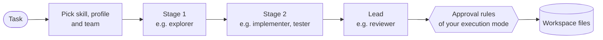

# Velune CLI: technical reference

The technical reference for [Velune CLI](https://github.com/Surya-Hariharan/Velune-CLI): installation and platform
support, optional extras, providers, file operations, memory, execution modes and permissions, MCP, configuration,
commands, and project status and licensing. For the overview, see the
[README](https://github.com/Surya-Hariharan/Velune-CLI#readme); for day-to-day use, the
[usage guide](usage-guide.md).

```bash
curl -fsSL https://raw.githubusercontent.com/Surya-Hariharan/Velune-CLI/main/scripts/install.sh | sh
```

On Windows, use the [PowerShell installer](#installation). Velune CLI is **beta software**; read the
[project status](#project-status-security-and-license) before relying on it for important work.

## Installation

### Install Velune CLI

**macOS, Linux, WSL**

```bash
curl -fsSL https://raw.githubusercontent.com/Surya-Hariharan/Velune-CLI/main/scripts/install.sh | sh
```

**Windows (PowerShell)**

```powershell
irm https://raw.githubusercontent.com/Surya-Hariharan/Velune-CLI/main/scripts/install.ps1 | iex
```

The installer puts Velune in its own isolated environment using [uv](https://docs.astral.sh/uv/). It does not need
Python to be installed: if Python is missing or too old, uv downloads a private copy. It adds `velune` to your `PATH`,
and running the same command again upgrades the installation. The scripts are fetched from the `main` branch and uv's
own installer is fetched from `astral.sh`; read the scripts first if that trust is not acceptable.

<details>
<summary>Install with pipx, uv or pip instead, and fix common install problems</summary>

```bash
pipx install velune-cli          # isolated, PATH managed
uv tool install velune-cli       # isolated, PATH managed
python -m pip install velune-cli # into the current Python environment
```

Use `python -m pip`, not bare `pip`, so the package goes into the same Python you will run it with. Plain pip needs
Python 3.10 or newer. Common problems:

- **`Could not find a version that satisfies the requirement velune-cli`** (with a `Requires-Python` note): your Python
  is older than 3.10. Check `python --version`.
- **`externally-managed-environment`** (Debian, Ubuntu, Homebrew Python): the OS protects its Python. Use the installer,
  `pipx`, `uv tool`, or a virtualenv.
- **Conflicts with other tools' dependencies:** pip keeps one copy of each package per environment. An isolated install
  avoids this. If Velune detects an incompatible dependency at startup, it names the package and the fix command.
- **`velune: command not found` / `'velune' is not recognized` (Windows):** the install worked, but your Python
  scripts directory is not on `PATH` (for `pip install --user` on Windows it is
  `%APPDATA%\Python\PythonXY\Scripts`). Run `velune doctor` (or `python -m velune doctor`): it names the directory and
  prints the fix. You can always use `python -m velune`, or reinstall with `pipx` or the installer. Velune never edits
  your `PATH` itself; open a new terminal after you change it.
- **Updating a pip install:** `velune update --check` shows the exact `python -m pip install --upgrade velune-cli`
  command for your interpreter. Velune does not update pip installs itself.

On the platforms marked **Tested** below, the core dependencies install from prebuilt wheels for CPython 3.10 to 3.14,
so no compiler is needed. CI checks this, including at the lowest allowed version of each dependency.

</details>

#### Platform support

| Platform | Status |
|---|---|
| Windows 10/11, x86-64 | **Tested** in CI |
| macOS, Apple Silicon (arm64) | **Tested** in CI |
| Linux, x86-64, glibc (Ubuntu, Debian, Fedora, …) | **Tested** in CI |
| Linux, arm64, glibc | Not tested. Prebuilt wheels exist for the core dependencies. |
| macOS, Intel (x86-64) | **Unverified.** In our lock file (`uv.lock`) the `cryptography` release has no macOS x86-64 wheel, so installing the base CLI may need a Rust toolchain to build it. The installer does not block it and it may work; we have not tested it or checked what PyPI currently offers. The optional `[rag]` extra is unavailable. |
| Alpine / other musl Linux | Not tested. Prebuilt wheels exist for the core dependencies. |
| WSL 2 | Not tested separately; treated as Linux. |
| **Windows on ARM64** | **Unsupported.** The installer stops before downloading anything. Required dependencies (`cryptography`, `tiktoken`) publish no Windows ARM64 wheels, so an install would need a Rust and C++ build toolchain. |
| 32-bit systems, BSD, other architectures | **Unsupported.** The installer stops before downloading anything. |

**Tested** means a CI job installs and runs it. **Not tested** means the
installer lets you proceed and our lock file has prebuilt wheels for the core
dependencies, so we expect it to work, but no CI job covers it. **Unverified**
means we found a gap that could make the install fail or need build tools, and
have not confirmed either way. **Unsupported** means the installer refuses to
run. None of these is a guarantee.

#### Verify the install

```bash
velune --version
velune doctor
```

If your shell says `velune` is not recognized, use `python -m velune --version` and `python -m velune doctor` instead;
they run the same code without needing the Scripts folder on `PATH` (see the troubleshooting entry above).

Updating: Velune checks PyPI at most once a day, asks once per new version, and installs an accepted update after you
quit (see `docs/lifecycle.md`). Set `[update] auto = "notify"` to only be told, or `"off"` (or
`VELUNE_NO_UPDATE_CHECK=1`) to make no request at all. Always close Velune before re-running the installer or
`pip install --upgrade`: replacing a running installation on Windows can delete its files part-way, and `velune
doctor` reports such a damaged install ("Installation Intact") with the command that repairs it.

`velune doctor` shows the Velune version, Python interpreter, operating system, and where Velune is installed and keeps
its data. It ends with "✓ Core installation is healthy." or a list of problems. Optional integrations (provider keys, a
local Ollama, extras such as `[rag]`) are reported but never counted as installation failures, and the exit code is
non-zero only when the core installation has a problem. `velune doctor --json` prints the same report as JSON with home
paths shortened to `~`, so it can be pasted into a bug report.

### Optional extras

The base install is small. Features that need heavier or compiled dependencies live in extras and turn themselves off
when the extra is missing (semantic search is disabled while keyword search keeps working).

| Extra | Enables |
| :--- | :--- |
| `rag` | Semantic memory and vector retrieval (`lancedb`, `pyarrow`, `qdrant-client`) |
| `parsing` | Tree-sitter parsing for repository cognition; lighter heuristics are used without it |
| `telemetry` | Export spans and metrics to an OTLP collector |
| `gguf`, `docker`, `api` | GGUF metadata reading; the Docker sandbox and the native Docker Engine integration (see [docs/docker.md](docker.md)); YAML OpenAPI specs for the HTTP integration |
| `postgres`, `mysql` | Drivers for the PostgreSQL and MySQL / MariaDB integrations (named connections, schema discovery, read-only queries, approved changes and transactions; see [docs/database.md](database.md)) |
| `all` | Every optional feature except the `postgres` and `mysql` drivers |

```bash
pip install 'velune-cli[rag]'
uv tool install --force 'velune-cli[rag]'   # add an extra to a uv tool or installer install
pipx install --force 'velune-cli[rag]'      # add an extra to a pipx install
```

The `rag` extra depends on LanceDB, which publishes prebuilt wheels only for Windows x86-64, macOS Apple Silicon and
glibc Linux (x86-64 and arm64), so it cannot be installed on musl Linux, Intel Macs or Windows ARM64. There is also a
`git` extra, kept only for compatibility, and a `dev` extra for contributors. The former `llamacpp` extra was removed
because `llama-cpp-python` depends on `diskcache`, which deserializes cache entries with `pickle` and has no patched
release. The llama.cpp adapter remains in the code and is available only if you install `llama-cpp-python` yourself,
which is not recommended outside a trusted single-user environment.

**Python:** 3.10 to 3.14 (CPython). CI runs the test suite on every combination of these versions with Windows, macOS
and Linux.

## First run

```bash
cd your-project
velune init                  # or: velune init --provider groq, then velune setup
velune
```

For a local model, install [Ollama](https://ollama.com) and run `ollama pull qwen2.5-coder:7b` first (for a remote
Ollama, set `OLLAMA_HOST`). `velune init` creates the project configuration and `.veluneignore` and builds the
repository index (`--no-index` skips it). If you skip it, the first time you open the REPL in that folder Velune starts
indexing in the background; set `[workspace] index_on_init = false` to turn that off. Run `velune doctor` at any time to
check your setup. The [usage guide](usage-guide.md) walks through a session.

## Architecture

`/council` hands a task to a team of agents. One model call picks a *skill* (how a kind of task is done, and its default
team) and a *permission profile* (what the agents may do, from answering only to editing files), then gives each agent
its own part. Agents in the same stage run at the same time, a later stage sees what the earlier ones found, and the
last agent writes the result. Every change still passes the approval rules of your execution mode, and one `/rewind`
undoes the whole run. `--skill` and `--permission` choose for you, `--bg` runs it read-only in the background, and
`/skills` lists skills and profiles; your own go in `~/.velune/skills/` and `~/.velune/permissions/`. A council costs
more calls and time than a single model and does not guarantee a good answer. Read diffs before accepting them.



Velune is one Python process. The CLI builds a runtime (configuration, providers and models first; repository, memory,
retrieval and execution subsystems warm up in the background), then routes each request through the provider layer.

<details>
<summary>Package map</summary>

| Package | Responsibility |
| :--- | :--- |
| `velune/cli` | Typer commands, full-screen REPL, slash commands, themes, onboarding |
| `velune/providers`, `velune/models` | Provider adapters, discovery, credentials, model registry |
| `velune/swarm` | `/council`: skills, permission profiles, planner, stage runner |
| `velune/orchestration` | The tool-calling loop |
| `velune/cognition` | Prompts, intent classification and the injection firewall |
| `velune/context` | Per-turn context assembly and token budget |
| `velune/memory`, `velune/retrieval` | Memory tiers, SQLite and vector stores, hybrid retrieval |
| `velune/repository`, `velune/intelligence`, `velune/knowledge` | Scanner, symbol and import index, incremental re-indexing, knowledge graph |
| `velune/execution`, `velune/permissions`, `velune/tools` | Command runner, path guard, diff preview, approval policy, tools |
| `velune/mcp`, `velune/hooks`, `velune/plugins`, `velune/resources` | MCP, lifecycle hooks, declarative plugins, integrations |
| `velune/recovery`, `velune/lifecycle` | Backup, restore, crash recovery; update, repair, uninstall |

Module boundaries and the bootstrap sequence are in the [development guide](development.md).

</details>

## Local and cloud providers

- **Local providers** send prompts to the endpoint you configured. That is your own machine by default, but a remote
  `OLLAMA_HOST` or an OpenAI-compatible server on another host receives your prompts and repository context.
- **Cloud providers** receive the prompt and whatever repository or memory context Velune includes. Their retention and
  training policies are set by the provider, not by Velune.
- **Chat can switch provider when one fails.** If the active provider is unreachable, rejects the key, is rate limited,
  times out or no longer has the model, and no tool has changed anything yet, the REPL retries the turn on your next
  configured provider and prints `Falling back to …`. A turn that started on a local model only falls back to other
  local models, so a failure never sends your prompt to a cloud provider. A turn on a cloud model may fall back to any
  configured provider.
- A council run keeps the models it started with: a failed call is retried on the same provider, never moved to
  another one.
- Velune has no analytics service and sends no usage data to its maintainers. Network traffic is limited to the
  providers, MCP servers, git hosts, web pages and integrations you use, plus a request to PyPI (at most once a day, and
  when you run `velune update`). `[update] auto = "off"` or `VELUNE_NO_UPDATE_CHECK=1` stops the daily check.
- API keys are stored AES-GCM-encrypted in your user configuration directory, with the encryption key in the OS keyring
  (or derived from `VELUNE_MASTER_PASSPHRASE` where none exists). A key saved through Velune takes precedence over a
  provider environment variable; set `VELUNE_PREFER_ENV_KEYS=1` to reverse that. Limits of this protection are in
  [SECURITY.md](https://github.com/Surya-Hariharan/Velune-CLI/blob/main/SECURITY.md#credential-protection).

Add a provider with `velune setup`, `velune provider add <id>` or `/connect <id>`; check it with
`velune provider test <id>` or `velune doctor providers`.

<details>
<summary>Supported providers</summary>

| Provider | Kind | Notes | Connect with |
| :--- | :--- | :--- | :--- |
| Ollama | Local | Any pulled model | `/model discover` |
| LM Studio | Local | Server must be running | `/connect lmstudio` |
| OpenAI-compatible | Local server | vLLM, LocalAI, text-generation-webui, and similar | `/connect openai-compat` |
| llama.cpp | Local, in-process | Needs `llama-cpp-python` installed manually | `/connect llamacpp` |
| Groq | Cloud | Free tier available | `/connect groq` |
| OpenRouter | Cloud | Many models through one key | `/connect openrouter` |
| OpenAI | Cloud | Chat models your key can use | `/connect openai` |
| Anthropic | Cloud | Claude models | `/connect anthropic` |
| xAI | Cloud | Grok models | `/connect xai` |
| Google | Cloud | Gemini models | `/connect google` |
| Together AI | Cloud | Open models | `/connect together` |
| Fireworks AI | Cloud | Open models | `/connect fireworks` |
| Mistral | Cloud | Mistral and Codestral models | `/connect mistral` |
| DeepSeek | Cloud | DeepSeek models | `/connect deepseek` |
| Cohere | Cloud | Command models | `/connect cohere` |
| Meta (Llama API) | Cloud | First-party Llama models | `/connect meta` |
| NVIDIA NIM | Cloud | build.nvidia.com chat models; `nvapi-…` key | `/connect nvidia` |
| Hugging Face | Cloud | Inference API | `/connect huggingface` |

Pricing and free-tier terms belong to each provider. Model lists for OpenAI, Anthropic, Google, Groq and NVIDIA NIM are
read from the provider when available; if a listing fails, Velune keeps the last known list and reports why.

</details>

<details>
<summary>Hardware guidance and models on an external drive</summary>

Velune detects RAM, GPU and accelerator at startup, classifies the machine, and prints warnings and suggestions. These
are suggestions only; hardware detection never changes which provider receives your prompts.

| RAM | Accelerator | Local models |
| :--- | :--- | :--- |
| under 8 GB | any | Not practical; use a cloud provider |
| 8 GB | integrated | About 3B-parameter models |
| 16 GB | integrated | 3B models run well; 7B models run slowly |
| 16 GB | 6 GB or more VRAM | 7B models |
| 32 GB | 12 GB or more VRAM | 13B models |
| 64 GB | 24 GB or more VRAM | 70B-class models |
| Apple Silicon, 16 GB or more | unified memory | 13B models |
| Apple Silicon, 36 GB or more | unified memory | 70B-class models |

**External drives.** Run `/model locate` (or `/model register <path>`) on the Ollama store folder, the one containing
`manifests/` and `blobs/`. If the drive is unplugged, the model stays listed as unavailable with the reason; reconnect
it and run `/model recheck`. If it returns under a different path, use `/model relocate <model> <new-path>`. A single
`.gguf` file or a safetensors folder can be registered with `/model register <path>`; that imports it into Ollama,
which copies the file, so Velune shows the size and asks first.

</details>

## Repository interaction and file operations

Velune can read, create, edit, move and delete files and run commands in your project, depending on the
[execution mode](#execution-modes-and-permissions).

- **Indexing.** Use `/index quick|standard|deep|status|rebuild` in the REPL, or `velune project init` from the shell
  (`velune status` reports index freshness). Besides the first-run background index described above, an index that has
  gone stale is refreshed in the background. Memory and retrieval stores live per workspace in your user data directory,
  not in the repository; a project's `.velune/` folder holds plans and small local files. `.veluneignore` excludes paths
  from indexing, and its default template excludes `.env`, `*.pem`, `*.key` and similar files.
- **Targeted edits.** The agent changes part of a file with `edit_file` (exact, unique string replacement) instead of
  rewriting it, and every change comes back to the model as a verified diff.
- **Safe writes.** Writes are atomic, keep each file's encoding and line endings (a CRLF file stays CRLF), and are
  refused if the file changed on disk since the agent last read it.
- **Path guard.** Filesystem and git tools resolve paths, including symlinks, and refuse anything outside the workspace
  unless you approve it. Changing `.git/`, `.velune/hooks.json` or `velune.toml` always asks first.
- **Diff preview.** In Manual mode every change is shown as a diff and applied only after you approve it.
- **Undo.** `/rewind` undoes the file changes from the agent's last turn. Velune does not commit council edits unless
  you set `execution.council_auto_commit = true`.

See [Filesystem tools](https://github.com/Surya-Hariharan/Velune-CLI/blob/main/docs/filesystem-tools.md) for every
tool, the safety model and provider support.

## Memory and repository cognition

Memory has four tiers, stored per workspace:

1. **Working:** current conversation turns, in process.
2. **Episodic:** session history in SQLite.
3. **Semantic:** vector search over past interactions (needs the `rag` extra).
4. **Lineage:** decisions and what was tried.

Separately, indexing builds a repository knowledge graph of files, symbols and imports. Retrieval combines BM25 keyword
search, vector search and graph signals, then reranks with a heuristic reranker. Without the `rag` extra, vector search
is disabled and keyword and graph retrieval keep working. A background watcher keeps the index current incrementally
once you have built it. Inspect memory with `velune memory stats|inspect|clear|compact`, and
trace a query with `velune pipeline trace "<query>"`. Each workspace has its own memory store, keyed by the folder's
absolute path, so same-named folders in different locations are kept apart.

## Execution modes and permissions

Velune can create, edit and delete files and run commands in your project. The **execution mode** decides what it may do
without asking. Press Shift+Tab to cycle modes, use the slash commands, or start with `velune --mode manual|plan|auto`.

| Mode | Command | Behavior |
| :--- | :--- | :--- |
| **Manual** (default) | `/manual` | Reads freely and asks before every change. Related changes are shown together for one approval. |
| **Plan** | `/plan [task]` | Writes a plan to `.velune/plans/<name>.md` without changing project files. Reply "approve" to run it. |
| **Auto** | `/auto` | Creates, edits and deletes files and runs commands inside the project without asking, until the task is done. |

In every mode Velune still asks before touching anything outside the project folder, before high-risk operations (for
example `git reset --hard`, `git clean`, force-push, recursive deletes, global installs), and before reading or changing
secrets. Commands such as `sudo` and disk formatting are not run. These rules are enforced in the tool layer rather than
by instructions to the model, and each decision is logged (`velune logs --type permission`).

**Limits.** Commands run as your user through a managed runner (allowlisted executables, no shell, resource limits).
That is process management, not OS-level isolation, and allowlisted interpreters can run any file in the workspace. For
isolation, enable the optional Docker sandbox (`execution.docker_sandbox = true`). The full threat model and known
limitations are in [SECURITY.md](https://github.com/Surya-Hariharan/Velune-CLI/blob/main/SECURITY.md).

Project-level hooks, `.mcp.json` servers and `base_url` overrides are honored only in directories you have trusted
(`velune trust add|list|forget`), so a repository you have just cloned cannot redirect your API traffic or start
processes through a configuration file.

## MCP, configuration and commands

**MCP.** `velune mcp serve` exposes Velune's tools to MCP-capable clients such as Claude Desktop or editors, over stdio
(read-only unless `VELUNE_MCP_ALLOW_MUTATIONS=1`). In the other direction, declare external servers (stdio, SSE, HTTP or
WebSocket) in `.mcp.json` or `[mcp.servers]` (project files are honored in trusted directories only) and connect with
`/mcp connect <name>`; `velune mcp connect <url> <name>` tests an SSE server from the shell. Cloud-metadata and
link-local addresses are always blocked, and `[mcp] allowed_hosts` can restrict connections further.
See [docs/mcp.md](https://github.com/Surya-Hariharan/Velune-CLI/blob/main/docs/mcp.md).

**Configuration.** Settings come from `velune.toml`, looked up in the workspace, then parent directories, then
`~/.velune/velune.toml`. A value in the file takes precedence over a `VELUNE_*` environment variable (nested keys use
`__`, for example `VELUNE_EXECUTION__MODE=plan`), and both override the built-in defaults. Read and change values with
`velune config show|get|set`. The repository's
[velune.toml](https://github.com/Surya-Hariharan/Velune-CLI/blob/main/velune.toml) shows the common settings at their
defaults, with explanations; integration settings are documented in the [Docker](docker.md), [database](database.md) and
[HTTP](http.md) guides.

```toml
[providers]
default_provider = "groq"

[execution]
mode = "manual"   # "manual", "plan" or "auto"
```

### Performance and background work

Velune keeps its own background work light, and has a few switches for slow machines or rate-limited providers.

- **Idle polling backs off.** The repository watcher starts at 3 s (git state at 10 s) and stretches to 30 s (60 s) after
  a quiet spell, returning to the base rate on the first change. The Ollama liveness probe does the same (5 s to 30 s).
  Each prompt re-checks for changes itself, so answers are not stale. `[workspace] watch_files = false` turns the
  watcher off entirely.
- **Animations pace themselves.** The spinner and streamed-text refresh slow down when the terminal is slow to repaint
  (long transcripts). `VELUNE_REDUCED_MOTION=1` (or `[display] reduced_motion = true`) stops the spinner animating.
- **Lighter council runs.** `[swarm]` sets the time, model-call and token limits of a `/council` run, and how many
  agents run at once (one at a time on a local model server).
  `[swarm.models]` gives a role its own model (`reviewer = "provider/model"`, or `lead` for whichever agent
  leads); a model that is unavailable is reported in the plan and the chat model is used.
- **Rate limits.** A provider's `Retry-After` is honoured up to 20 s; a longer wait fails fast with the provider's error
  instead of stalling the run. At most 4 requests per provider are in flight, and at most 4 startup model probes.
- **Optional vector memory.** Vector stores need the `rag` extra. `VELUNE_SKIP_LANCEDB=1` and `VELUNE_SKIP_QDRANT=1`
  force them into a no-op mode.

### Commands

Run `velune --help` or `velune <command> --help` for full signatures. Inside the REPL there are 43 slash commands in 12
categories; press Tab to complete, and run `/help` for aliases and usage. The status bar shows background jobs (`bg:N`),
unread proactive alerts (`alerts:N`) and MCP connection counts.

<details>
<summary>All terminal commands</summary>

| Group | Commands |
| :--- | :--- |
| Core | `velune` (REPL), `chat` (the same REPL; `--session <id>` resumes), `run "<task>"`, `ask "<question>"`, `init`, `onboard` |
| Workspace and sessions | `project init\|status\|graph\|tree\|list\|open\|resume\|explain\|forget` (alias `workspace`), `session list\|resume\|show\|delete\|import\|rename\|search\|archive\|unarchive\|export` |
| Setup and models | `setup`, `models scan\|list\|refresh\|pull\|delete\|use\|benchmark\|health\|show`, `provider list\|add\|remove\|test\|models\|status\|api\|edit\|inspect\|default\|backup\|restore\|repair`, `config show\|get\|set`, `trust add\|list\|forget` |
| Analytics and monitoring | `usage`, `quota`, `health` |
| Diagnostics | `doctor [providers\|network]`, `logs [recent\|live]`, `status`, `pipeline trace "<query>"`, `daemon start\|stop\|status`, `mcp serve\|connect`, `memory stats\|inspect\|clear\|compact` |
| Lifecycle | `update [--check]`, `repair`, `uninstall`, `purge-data` |
| Trust and recovery | `backup`, `restore`, `recover` |

`update --check` is read-only and works for any install. Applying an update, and `repair` and `uninstall`, change only a
uv-installed copy and refuse other install methods. They leave your data in place; only `purge-data` deletes it. See
[docs/lifecycle.md](https://github.com/Surya-Hariharan/Velune-CLI/blob/main/docs/lifecycle.md) and
[docs/data-inventory.md](https://github.com/Surya-Hariharan/Velune-CLI/blob/main/docs/data-inventory.md). The full
slash-command reference is in
[docs/slash-commands.md](https://github.com/Surya-Hariharan/Velune-CLI/blob/main/docs/slash-commands.md).

</details>

## More documentation

[Usage guide](usage-guide.md) · [Slash commands](slash-commands.md) · [Filesystem tools](filesystem-tools.md) ·
[MCP](mcp.md) · [Docker](docker.md) · [Databases](database.md) · [HTTP](http.md) · [Lifecycle](lifecycle.md) ·
[Data inventory](data-inventory.md) · [Development](development.md) · [Project origin](project-origin.md)

To contribute, read [CONTRIBUTING.md](https://github.com/Surya-Hariharan/Velune-CLI/blob/main/CONTRIBUTING.md); it covers setup, the checks CI runs, and how to add a
provider or command. Known gaps: Intel macOS is unverified, Linux arm64 and musl are not covered by CI (see
[Platform support](#platform-support)), command execution is not sandboxed unless you enable the Docker sandbox, and
Velune pins `mcp<2.0.0` until its server code is migrated to the new API.

## Project status, security and license

**Status.** Velune CLI is **beta** (version 0.x). Command names, configuration keys and on-disk formats may change
between minor releases, and the documentation on `main` can describe changes that are not in the latest PyPI release
yet: compare `velune --version` with the
[changelog](https://github.com/Surya-Hariharan/Velune-CLI/blob/main/CHANGELOG.md). Experimental features are labelled
in this document.

**Security.** Do not report vulnerabilities in public issues. Use a
[private GitHub security advisory](https://github.com/Surya-Hariharan/Velune-CLI/security/advisories/new). The policy,
threat model and response targets are in
[SECURITY.md](https://github.com/Surya-Hariharan/Velune-CLI/blob/main/SECURITY.md).

**License and attribution.** Velune CLI is licensed under the
[Apache License 2.0](https://github.com/Surya-Hariharan/Velune-CLI/blob/main/LICENSE). Copyright 2026 Surya HA. Velune
CLI was created and is maintained by Surya HA. This repository is the canonical source; official releases are the tags
and GitHub Releases published here and the [`velune-cli`](https://pypi.org/project/velune-cli/) package on PyPI. If you
redistribute the software or a derivative, keep the copyright and
[NOTICE](https://github.com/Surya-Hariharan/Velune-CLI/blob/main/NOTICE) attributions as the license requires.

The license applies to the source code. Under Section 6 of the license it does not grant permission to use the "Velune"
and "Velune CLI" names, wordmark or logo other than for reasonable and customary description of the origin of the work.
This is a statement about project naming, not a claim of registered trademark status. Forks are welcome; they are
separate projects and should not present themselves as the canonical Velune CLI. Third-party product and company names
(for example Claude, Ollama, OpenAI) belong to their owners and are used only to identify the services Velune can
connect to. The images in `docs/assets/` were created for this project and are part of the repository, so the
repository license applies to them. See [AUTHORS.md](https://github.com/Surya-Hariharan/Velune-CLI/blob/main/AUTHORS.md) and
[GOVERNANCE.md](https://github.com/Surya-Hariharan/Velune-CLI/blob/main/GOVERNANCE.md).
