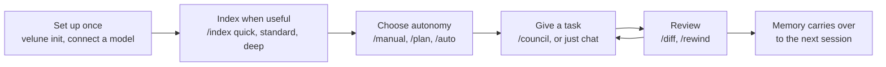

# Usage Guide

*Practical guidance for getting good results out of Velune CLI day to day.*

This guide explains how to work with Velune: what to do first on a new project, how to
choose a model and a level of autonomy, how to review changes, and what to check when
something looks wrong. It assumes Velune is already installed (see the
[reference](reference.md#installation)). For the exact syntax of every REPL command, see
[Slash Commands](slash-commands.md); for how the codebase is put together, see the
[Development Guide](development.md).

---

## Contents

- [The shape of a session](#the-shape-of-a-session)
- [1. First session on a new project](#1-first-session-on-a-new-project)
- [2. Picking a model](#2-picking-a-model)
- [3. Choosing how much Velune may do](#3-choosing-how-much-velune-may-do)
- [4. Choosing how a task runs](#4-choosing-how-a-task-runs)
- [5. Reviewing what changed](#5-reviewing-what-changed)
- [6. Making Velune remember your codebase](#6-making-velune-remember-your-codebase)
- [7. Working across multiple projects](#7-working-across-multiple-projects)
- [8. Extending Velune for your team](#8-extending-velune-for-your-team)
- [9. Connecting external tools](#9-connecting-external-tools)
- [10. Diagnosing problems](#10-diagnosing-problems)
- [11. Recovering from a bad state](#11-recovering-from-a-bad-state)

---

## The shape of a session

Most sessions follow the same loop. Each step has a section below, and you can skip steps
you do not need: a quick question needs neither an index nor a council.



A short example of the loop, in the REPL:

```text
/index standard            # build the symbol index (one time, then kept fresh)
/model use <id>            # pick a model you have connected
/council add input validation to the signup handler
/diff                      # see what changed on disk
/rewind                    # undo the file changes from the agent's last turn
```

In the default Manual mode, Velune shows each change and waits for your approval before it
touches a file, so `/diff` mostly confirms what you already accepted.

---

## 1. First session on a new project

```bash
cd your-project
velune init      # one-time: project configuration, .veluneignore and a first index
velune           # opens the REPL; asks whether to trust a new folder
```

The REPL opens immediately. In a folder it recognises as a project it also starts an index in the
background, which you can turn off with `[workspace] index_on_init = false`. Run `/index` yourself,
sized to what you are about to do, when you want a particular depth:

| Command | Cost | Use for |
| --- | --- | --- |
| `/index quick` | Seconds | Manifest-only scan: quick orientation, "what is in this repo" |
| `/index standard` | Depends on repository size | Full symbol index: most day-to-day work |
| `/index deep` | Slowest | Symbols, import graph and relationships: refactors, blast-radius questions |

> `/index` is the primary command; `/cognition` and `/cog` still work as aliases for
> backward compatibility. `/index status` shows freshness, and `/index rebuild` forces a
> full rescan.

Without an index, chat and `/council` still work; they just start with less repository context
(see [Choosing how a task runs](#4-choosing-how-a-task-runs)).

Once you have indexed, most of the upkeep happens off the prompt path: a background engine
watches the filesystem and keeps the index current incrementally, without re-scanning the
whole repository on every turn. `velune status` shows what is indexed and how fresh it is.

---

## 2. Picking a model

Run `/model discover` to find what is already available locally (Ollama, LM Studio), or
`/connect` to add a cloud provider key (also `velune provider add <id>` from the terminal).
Keys are stored encrypted (AES-GCM) in your user config directory. The encryption key lives
in your OS keyring, or is derived from `VELUNE_MASTER_PASSPHRASE` on headless machines. Keys
are never written to `velune.toml`. Then `/model use <id>` (or the `/model` palette, or
Alt+Up/Down) switches the active model.

**When something is not reachable.** Velune tells apart "the key was rejected" from
everything else (offline, timed out, rate-limited, provider down, key not allowed to list
models). Only a rejected key is refused; otherwise the key is saved and re-checked
automatically. A local model whose server is stopped or whose drive is unplugged stays in
the list, marked unavailable with the reason. These commands handle those cases:

| Command | Use it to |
| --- | --- |
| `/model status` | See whether the active model is available, its endpoint or storage path, and which key is in use |
| `/model recheck [id]` | Re-test now (after reconnecting a drive or starting `ollama serve`); for a cloud model, re-verifies the key |
| `/model relocate <id> <path>` | Point a model at its new location when a drive mounts under a different path |
| `/model register <path>` | Add an Ollama store folder (in place), or import a `.gguf` file or safetensors folder into Ollama (this copies it, and you are asked first) |
| `/model remove <id>` | Forget a model registration (model files are never touched) |

**Rule of thumb.** Local models are fine for explaining code and small edits. Keep your
largest or most expensive model for security reviews and cross-cutting refactors. A
`/council` run makes several model calls, so do not use it for a one-line question.

Remember that a cloud model receives your prompt and the repository context Velune attaches
to it. The [reference](reference.md#local-and-cloud-providers) explains which providers keep
your data on your machine.

---

## 3. Choosing how much Velune may do

Velune can create, edit and delete files and run commands in your project. The **execution
mode** decides what it may do without asking. Press Shift+Tab to cycle modes, use the slash
commands, or start with `velune --mode manual|plan|auto`.

| Mode | Command | What happens |
| --- | --- | --- |
| **Manual** (default) | `/manual` | Reads and analyzes freely, and asks before every change. Related changes are shown together for one approval. |
| **Plan** | `/plan [task]` | Investigates and writes a plan to `.velune/plans/<name>.md` without changing project files. Revise the plan as often as you like, then reply "approve" to run it. |
| **Auto** | `/auto` | Creates, edits and deletes files and runs commands inside the project without asking, iterating (edit, test, fix) until the task is done. |

Which mode to use:

- **Manual** when you are learning how Velune behaves or working in code you care about.
- **Plan** for larger or riskier work where you want to agree on the approach first.
- **Auto** for well-understood tasks in a repository with good tests and version control,
  where you will review the result afterwards.

In every mode Velune still asks before touching anything outside the project folder, before
high-risk operations (such as `git reset --hard`, `git clean`, force-push or recursive
deletes), and before reading or changing secrets. These rules are enforced in the tool
layer, not only requested of the model. See [SECURITY.md](../SECURITY.md) for the details
and the limits.

---

## 4. Choosing how a task runs

Ordinary chat uses one model with tools. `/council <task>` gives the task
to a team of agents instead:

1. A **skill** is chosen: `coding`, `planning`, `review` or `research`. The skill sets the
   roles, their order and what the team delivers.
2. A **permission profile** is chosen. It decides which tools, files and MCP servers the team
   may use, from `answer-only` to `build-project`.
3. The team is shown to you (agents, stages, sub-tasks), then runs. Agents in the same stage
   work at the same time; agents that change files never do.
4. One agent, the lead, delivers the result. Proposed edits go through your approval.

`/skills` lists the skills and profiles, and `/skills show <name>` prints one. Name them
yourself when you know better:

```text
/council --skill review check the permission gate for bypasses
/council --skill coding --permission read-only add input validation to signup
/council show              # recent runs; /council show <id> for one run
```

Your execution mode still applies: Plan mode changes nothing, whatever the profile says. A run
stops at the time, model-call and token limits in the `[swarm]` section of `velune.toml`. You
can add your own skills and profiles; see [CONTRIBUTING.md](../CONTRIBUTING.md).

`/mode fast`, `/mode max` and `/mode normal` are separate: they set the model and context
size for the session.

For anything that will take a while, `/council --bg <task>` submits it as a background job and
returns your prompt immediately. A background job only reads and answers. `/jobs` and
`/dashboard` track progress, and the status bar shows a live `bg:N` counter.

---

## 5. Reviewing what changed

Velune edits files on disk rather than pasting diffs into chat. After a run:

- `/diff` shows the uncommitted changes in the working tree.
- `/rewind` undoes the file changes the agent made in its last turn: edited and deleted
  files come back, created ones are removed, moved ones return. A file you changed after
  the turn is left alone and reported.

The agent edits part of a file with `edit_file` rather than rewriting it, and keeps each
file's encoding and line endings. If you save a file while the agent is working on it, its
next change to that file is refused as a conflict and it re-reads the file first. See
[Filesystem tools](filesystem-tools.md) for the full list of tools and the safety model.

A council improves the odds of a good answer but does not guarantee one. Read the diff
before you accept it, especially in Auto mode.

---

## 6. Making Velune remember your codebase

Memory has four tiers per workspace (working, episodic, semantic and lineage), so context can
accumulate across sessions without you re-explaining it. It only has something to draw on once
you have used the tool for a while:

- **Working** memory holds the current conversation.
- **Episodic** memory persists your conversation history per workspace.
- **Semantic** memory lets "fix the auth thing from yesterday" resolve to the actual prior
  conversation and files touched, once there is session history to search. It needs the
  optional `rag` extra.
- **Lineage** memory records decisions and what was tried.

Indexing separately builds a graph of the repository's files, symbols and imports, which
retrieval also draws on.

`/memory` shows what is actually populated, and `/context` shows how many tokens the current
conversation uses out of the model's context window. If a prompt seems to ignore history it
should know about, check `/memory` before blaming the model: an empty or stale tier is a
common cause.

`/memory clear` clears **working memory only** (the current turns), after a confirmation. To
remove stored data, use `velune memory clear <working|episodic|all>` in the terminal, or
`velune purge-data` (see the [data inventory](data-inventory.md)).

> **How sources are chosen.** Which sources feed a given answer, and how much of each, is
> decided by intent-aware retrieval rather than a fixed mix. Keyword (BM25), vector and
> graph results are fused with weights chosen per intent (search-style prompts lean on
> keywords; refactors and dependency questions lean on the graph), then reranked
> heuristically.

From the terminal, memory commands are `velune memory stats|inspect|clear|compact`.

---

## 7. Working across multiple projects

`/project list` and `/project open <path>` switch workspaces without restarting the REPL.
Each workspace has its own index, memory and MCP configuration. `/project add <path>`
registers a workspace you want to switch to later without opening it immediately. From the
terminal, `velune session list` shows saved sessions, and `velune session resume|delete <id>`
act on one.

---

## 8. Extending Velune for your team

There are three ways to add project- or team-specific behavior, roughly in order of how
much you want to share:

1. **File-based slash commands.** A TOML file defines a one-off command. This is the fastest
   to write, and it is not portable outside the repository unless you commit it alongside
   the code. A command whose action is `shell` runs through your shell with your
   privileges when you invoke it, so review these files before you use a repository you did
   not write.
2. **Declarative plugins.** A `plugin.json` manifest bundles commands, skills, hooks and MCP
   servers as one unit under `<workspace>/.velune/plugins/` (or `~/.velune/plugins/` for
   personal, cross-project plugins). This is best when you want to share a coherent bundle,
   because it is one thing to enable or disable (`/plugin`) rather than several loose files.
3. **Hooks.** External commands run on lifecycle events
   (`PreToolUse`, `PostToolUse`, `SessionStart`, and others), configured in
   `velune.toml [hooks]` or `.velune/hooks.json`. Use them for policy, such as "run a linter
   after every file write" or "block commits to `main`", rather than for new functionality.
   Project-level hooks load only in directories you have trusted.

See the extension-points table in the
[Development Guide](development.md#5-extension-points--the-design-pattern-behind-all-of-them)
for where each configuration file lives.

---

## 9. Connecting external tools

- **MCP.** To use Velune's tools from Claude Desktop, VS Code or another MCP-capable editor,
  run `velune mcp serve`. To pull tools *into* Velune from an external MCP server, declare
  it in `.mcp.json` and use `/mcp connect <name>`. See [mcp.md](mcp.md) for trust gating and
  transport details. Outbound connections are trust-gated per workspace, so a repository you
  have not explicitly trusted will not silently load its `.mcp.json`.
- **Application integrations.** Velune can work with Docker, HTTP APIs, PostgreSQL, MySQL /
  MariaDB, Supabase and its own background processes. Run `/resource discover` to see what a
  project uses and `/resource configure <id>` to store a database or HTTP credential
  (encrypted; the model sees only its name). Connector actions follow your execution mode like
  any other change: reads run, Manual asks before a change, Plan refuses it, and Auto still
  asks for destructive operations and for anything the task did not create. The agent enables
  only the integrations a task needs; set `resources.expose_to_model = false` in `velune.toml`
  to keep them away from the model. In `/council` with the `integrations` profile every agent
  can read through them and only the lead can change anything; `velune ask`, `velune run` and
  MCP runs do not get them. Guides: [Docker](docker.md), [databases](database.md),
  [HTTP and API testing](http.md); how connectors are authorized is in the
  [development guide](development.md#resource-connectors-and-the-authorization-pipeline).
- **GitHub and GitLab.** `/push`, `/pr` and `/issue` use the same git and REST integrations
  as the git tools. They need no separate setup beyond a configured `git` and, for pull
  request and issue commands, a token available to the underlying REST client.

---

## 10. Diagnosing problems

Start with `/doctor` (in the REPL) or `velune doctor` (in the terminal). Both check the
installation, providers, storage, configuration and the council's skills; the terminal run also
checks memory health. `velune doctor --fix` remediates what it safely can, and `--perf` times
startup. More specific checks:

- `velune doctor providers` checks connectivity to every configured provider.
- `velune doctor network` pings every registered provider and shows a status table.
- `velune logs` and `velune logs live` show recent or streaming execution events read back
  from the trace log. `velune logs --type permission` shows the approval decisions.
- `velune status` shows index freshness, file and symbol counts, and workspace health, read
  from on-disk state.
- `velune pipeline trace "<query>"` traces a query through the retrieval pipeline (lexical,
  vector and graph hit counts, timings, fusion).

`velune status` and `velune logs` exist so you can show, to yourself or someone else, that
indexing or a tool call really happened, and not only that a command returned success.

**Which check first?** If Velune seems to be ignoring something you said earlier in the
session, check `/context` first (is the conversation near the model's limit?) and `/memory`
second (was anything persisted?).

---

## 11. Recovering from a bad state

`velune backup`, `velune restore` and `velune recover` cover the "something went wrong"
cases:

- `recover` is designed for the REPL-crash case, using a per-turn autosave that the REPL
  keeps automatically.
- `backup` and `restore` are the manual, explicit path for moving or restoring the full
  state (sessions, config, providers, memory, trust) as one archive. They are useful before
  a risky operation such as `velune memory clear all`, or before upgrading Velune itself.

Restore only archives you made yourself: an archive carries the workspace trust list. See
[SECURITY.md](../SECURITY.md#backup-and-recovery-secrets).
