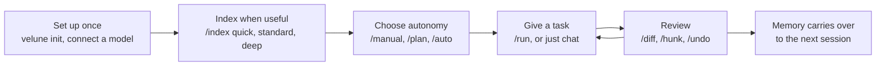

# Usage Guide

*Practical guidance for getting good results out of Velune CLI day to day.*

This guide explains how to work with Velune: what to do first on a new project, how to
choose a model and a level of autonomy, how to review changes, and what to check when
something looks wrong. It assumes Velune is already installed (see the
[README](../README.md#installation)). For the exact syntax of every REPL command, see
[Slash Commands](slash-commands.md); for how the codebase is put together, see the
[Development Guide](development.md).

---

## Contents

- [The shape of a session](#the-shape-of-a-session)
- [1. First session on a new project](#1-first-session-on-a-new-project)
- [2. Picking a model](#2-picking-a-model)
- [3. Choosing how much Velune may do](#3-choosing-how-much-velune-may-do)
- [4. Choosing how a task runs](#4-choosing-how-a-task-runs)
- [5. Reviewing what changed](#5-reviewing-what-changed)
- [6. Making Velune remember your codebase](#6-making-velune-remember-your-codebase)
- [7. Working across multiple projects](#7-working-across-multiple-projects)
- [8. Extending Velune for your team](#8-extending-velune-for-your-team)
- [9. Connecting external tools](#9-connecting-external-tools)
- [10. Diagnosing problems](#10-diagnosing-problems)
- [11. Recovering from a bad state](#11-recovering-from-a-bad-state)

---

## The shape of a session

Most sessions follow the same loop. Each step has a section below, and you can skip steps
you do not need: a quick question needs neither an index nor a council.



A short example of the loop, in the REPL:

```text
/index standard            # build the symbol index (one time, then kept fresh)
/model use <id>            # pick a model you have connected
/run add input validation to the signup handler
/diff                      # see what changed on disk
/rewind                    # undo the file changes from the agent's last turn
/undo                      # revert the last Velune-authored commit, if you do not want it
```

In the default Manual mode, Velune shows each change and waits for your approval before it
touches a file, so `/diff` mostly confirms what you already accepted.

---

## 1. First session on a new project

```bash
cd your-project
velune init      # one-time: registers the workspace, trust prompt if new
velune           # opens the REPL
```

Velune does **not** index your repository automatically. The REPL opens immediately, with
no symbol index built. This is deliberate: indexing a large repository can take real time
and CPU, and most sessions (a quick question, a one-file edit) do not need it. Build the
index explicitly, sized to what you are about to do:

| Command | Cost | Use for |
| --- | --- | --- |
| `/index quick` | Seconds | Manifest-only scan: quick orientation, "what is in this repo" |
| `/index standard` | Depends on repository size | Full symbol index: most day-to-day work |
| `/index deep` | Slowest | Symbols, import graph and relationships: refactors, blast-radius questions |

> `/index` is the primary command; `/cognition` and `/cog` still work as aliases for
> backward compatibility. `/index status` shows freshness, and `/index rebuild` forces a
> full rescan.

If you skip this step, `/run` still works. The council just has less repository context to
draw on, and complex tasks may be classified into a lower tier than they deserve (see
[Choosing how a task runs](#4-choosing-how-a-task-runs)).

Once you have indexed, most of the upkeep happens off the prompt path: a background engine
watches the filesystem and keeps the index current incrementally, without re-scanning the
whole repository on every turn. `velune status` and `velune context` show what is indexed
and how fresh it is.

---

## 2. Picking a model

Run `/model discover` to find what is already available locally (Ollama, LM Studio), or
`/connect` to add a cloud provider key (also `velune provider add <id>` from the terminal).
Keys are stored encrypted (AES-GCM) in your user config directory. The encryption key lives
in your OS keyring, or is derived from `VELUNE_MASTER_PASSPHRASE` on headless machines. Keys
are never written to `velune.toml`. Then `/model use <id>` (or the `/model` palette, or
Alt+Up/Down) switches the active model.

**When something is not reachable.** Velune tells apart "the key was rejected" from
everything else (offline, timed out, rate-limited, provider down, key not allowed to list
models). Only a rejected key is refused; otherwise the key is saved and re-checked
automatically. A local model whose server is stopped or whose drive is unplugged stays in
the list, marked unavailable with the reason. These commands handle those cases:

| Command | Use it to |
| --- | --- |
| `/model status` | See whether the active model is available, its endpoint or storage path, and which key is in use |
| `/model recheck [id]` | Re-test now (after reconnecting a drive or starting `ollama serve`); for a cloud model, re-verifies the key |
| `/model relocate <id> <path>` | Point a model at its new location when a drive mounts under a different path |
| `/model register <path>` | Add an Ollama store folder (in place), or import a `.gguf` file or safetensors folder into Ollama (this copies it, and you are asked first) |
| `/model remove <id>` | Forget a model registration (model files are never touched) |

**Rule of thumb.** Local models are fine for `INSTANT` and `STANDARD` tier work (explaining
code, small edits). Reserve your largest or most expensive model for `FULL` tier tasks
(security review, cross-cutting refactors) through `/max` or `/council`, so you are not
paying full-council cost for a one-line question.

Remember that a cloud model receives your prompt and the repository context Velune attaches
to it. The [README](../README.md#local-and-cloud-providers) explains which providers keep
your data on your machine.

---

## 3. Choosing how much Velune may do

Velune can create, edit and delete files and run commands in your project. The **execution
mode** decides what it may do without asking. Press Shift+Tab to cycle modes, use the slash
commands, or start with `velune --mode manual|plan|auto`.

| Mode | Command | What happens |
| --- | --- | --- |
| **Manual** (default) | `/manual` | Reads and analyzes freely, and asks before every change. Related changes are shown together for one approval. |
| **Plan** | `/plan [task]` | Investigates and writes a plan to `.velune/plans/<name>.md` without changing project files. Revise the plan as often as you like, then reply "approve" to run it. |
| **Auto** | `/auto` | Creates, edits and deletes files and runs commands inside the project without asking, iterating (edit, test, fix) until the task is done. |

Which mode to use:

- **Manual** when you are learning how Velune behaves or working in code you care about.
- **Plan** for larger or riskier work where you want to agree on the approach first.
- **Auto** for well-understood tasks in a repository with good tests and version control,
  where you will review the result afterwards.

In every mode Velune still asks before touching anything outside the project folder, before
high-risk operations (such as `git reset --hard`, `git clean`, force-push or recursive
deletes), and before reading or changing secrets. These rules are enforced in the tool
layer, not only requested of the model. See [SECURITY.md](../SECURITY.md) for the details
and the limits.

`/approve safe|ask|block` is a separate, session-scoped control over individual tool calls:

- `safe`: known read-only calls run without asking; writes and commands prompt.
- `ask` (default): you see everything non-trivial.
- `block`: calls are rejected, which suits stepping through a task you are not sure about
  or working in a sensitive repository.

---

## 4. Choosing how a task runs

Every `/run` goes through automatic tier classification. It is not "always full council",
and it is not "always the fast path" either:

- Explaining, describing, or answering "what is X" style prompts: `INSTANT`.
- Ordinary edits and small features: `STANDARD` or `MINIMAL`.
- Refactors, security-sensitive changes, migrations: `FULL`.
- **Regardless of keywords**, if a file you mention has dependents in the repository's import
  graph, Velune raises the tier automatically (1 or more dependents: at least `MINIMAL`;
  3 or more: at least `STANDARD`; 5 or more: `FULL`). A one-line prompt touching a
  widely imported file gets full council treatment even if it does not sound like a
  "refactor".

This escalation only works with an index (`/index standard` or deeper). Without one, Velune
has no dependency data to escalate on, so it is worth indexing before a task that touches a
central file.

Override the classifier directly when you know better:

- `/council <task>` forces the full council regardless of what the classifier would pick.
- `/fast` pins everything to the instant tier, the smallest model and a 4k context for the
  whole session (good for a burst of quick questions).
- `/max` pins the full council, the largest model and a 128k context for the whole session
  (good before a big refactor pass).
- `/normal` returns to automatic classification (16k context, adapting further to your
  hardware profile).

For anything that will take a while, `/run --bg <task>` submits it as a background job and
returns your prompt immediately. `/jobs` and `/dashboard` track progress, and the status bar
shows a live `bg:N` counter.

---

## 5. Reviewing what changed

Velune edits files on disk rather than pasting diffs into chat. After a run:

- `/diff` shows what actually changed on disk from the last council run.
- `/hunk` switches to hunk-by-hunk review before edits are accepted, for finer control than
  "accept everything".
- `/rewind` undoes the file changes the agent made in its last turn: edited and deleted
  files come back, created ones are removed, moved ones return. A file you changed after
  the turn is left alone and reported.
- `/undo` reverts the last Velune-authored git commit. The changes stay staged, so you can
  inspect them before deciding what to do next.

The agent edits part of a file with `edit_file` rather than rewriting it, and keeps each
file's encoding and line endings. If you save a file while the agent is working on it, its
next change to that file is refused as a conflict and it re-reads the file first. See
[Filesystem tools](filesystem-tools.md) for the full list of tools and the safety model.

A council improves the odds of a good answer but does not guarantee one. Read the diff
before you accept it, especially in Auto mode.

---

## 6. Making Velune remember your codebase

The five-tier memory system (working, episodic, semantic, graph, lineage) lets context
accumulate across sessions without you re-explaining it. It only has something to draw on
once you have used the tool for a while:

- **Episodic** memory persists your conversation history per workspace.
- **Semantic** memory lets "fix the auth thing from yesterday" resolve to the actual prior
  conversation and files touched, once there is session history to search. It needs the
  optional `rag` extra.
- **Graph** memory captures repository structure once the repository is indexed.

`/memory stats` shows what is actually populated. `/context` shows how much of your active
context window is being spent on retrieved memory versus your current conversation. If a
prompt feels like it is ignoring history it should know about, check `/memory stats` before
assuming the model is at fault: an empty or stale tier is a common cause.

`/memory clear` is destructive. It drops the persisted SQLite, Qdrant and LanceDB state for
the workspace, not just the current turn, and prompts for confirmation. Use it when memory
has gone stale or wrong, not routinely.

> **How sources are chosen.** Which sources feed a given answer, and how much of each, is
> decided by intent-aware retrieval rather than a fixed mix. Keyword (BM25), vector and
> graph results are fused with weights chosen per intent (search-style prompts lean on
> keywords; refactors and dependency questions lean on the graph), then reranked
> heuristically.

From the terminal, the equivalent commands are `velune memory stats|inspect|clear|compact`.

---

## 7. Working across multiple projects

`/project list` and `/project open <path>` switch workspaces without restarting the REPL.
Each workspace has its own index, memory and MCP configuration. `/project add <path>`
registers a workspace you want to switch to later without opening it immediately. From the
terminal, `velune session list` and `velune session delete <id>` manage saved sessions in
bulk.

---

## 8. Extending Velune for your team

There are three ways to add project- or team-specific behavior, roughly in order of how
much you want to share:

1. **File-based slash commands.** A TOML file defines a one-off command. This is the fastest
   to write, and it is not portable outside the repository unless you commit it alongside
   the code. A command whose action is `shell` runs through your shell with your
   privileges when you invoke it, so review these files before you use a repository you did
   not write.
2. **Declarative plugins.** A `plugin.json` manifest bundles commands, skills, hooks and MCP
   servers as one unit under `<workspace>/.velune/plugins/` (or `~/.velune/plugins/` for
   personal, cross-project plugins). This is best when you want to share a coherent bundle,
   because it is one thing to enable or disable (`/plugin`) rather than several loose files.
3. **Hooks.** External commands run on lifecycle events
   (`PreToolUse`, `PostToolUse`, `SessionStart`, and others), configured in
   `velune.toml [hooks]` or `.velune/hooks.json`. Use them for policy, such as "run a linter
   after every file write" or "block commits to `main`", rather than for new functionality.
   Project-level hooks load only in directories you have trusted.

See the extension-points table in the
[Development Guide](development.md#5-extension-points--the-design-pattern-behind-all-of-them)
for where each configuration file lives.

---

## 9. Connecting external tools

- **MCP.** To use Velune's tools from Claude Desktop, VS Code or another MCP-capable editor,
  run `velune mcp serve`. To pull tools *into* Velune from an external MCP server, declare
  it in `.mcp.json` and use `/mcp connect <name>`. See [mcp.md](mcp.md) for trust gating and
  transport details. Outbound connections are trust-gated per workspace, so a repository you
  have not explicitly trusted will not silently load its `.mcp.json`.
- **Resource connectors.** For Velune to query a database or container directly (Docker,
  Postgres, MySQL, Supabase), use `/resource discover`, then `/resource configure <id>` for
  the database connectors. Credentials are encrypted at rest and masked in anything Velune
  shows or sends. Connector actions follow your execution mode like any other change: reads
  always run, Manual asks, Plan refuses, and Auto still asks for destructive operations and for
  anything this task did not create, such as a container that was already running. That friction
  is intentional for actions against real infrastructure. The agent does not see these tools up
  front: it asks which integrations exist, enables the ones the task needs (their tools appear on
  its next turn) and can also start, read the output of, wait for and stop its own background
  commands. Enabling a tool never approves it; every call is still checked as above. Set
  `resources.expose_to_model = false` in `velune.toml` to keep integrations away from the model.
- **HTTP and API testing.** The agent can send requests to a local dev server or a remote API,
  check responses with assertions, run saved API collections and explore an OpenAPI spec, with
  no Postman installation. Describe your API once in `velune.toml` (`[resources.http]` with
  `trusted_origins` and `[resources.http.environments.<name>]` for `base_url`, variables and a
  credential reference), store tokens with `/resource configure http <reference>` (encrypted,
  and each one is sent only to its own origin), then ask, for example, "test the login API on my
  local backend". Reads run; Manual asks before a change; Plan refuses one; Auto still asks for a
  DELETE, for changes to a production environment and for changes to a remote service you have not
  trusted. Running a collection is approved for all of its requests at once. Cloud-metadata and
  private-network addresses are never reachable. See [http.md](http.md).
- **GitHub and GitLab.** `/push`, `/pr` and `/issue` use the same git and REST integrations
  as the git tools. They need no separate setup beyond a configured `git` and, for pull
  request and issue commands, a token available to the underlying REST client.

---

## 10. Diagnosing problems

Start with `/doctor` (in the REPL) or `velune doctor check` (in the terminal). The terminal
version is more thorough: it checks providers, storage, security posture, performance and
council role coverage in one pass, and `--fix` remediates what it safely can. More specific
checks:

- `velune doctor providers` checks connectivity to every configured provider.
- `velune doctor network` runs the SSRF and reachability checks relevant to MCP and resource
  connectors.
- `velune logs` and `velune logs live` show recent or streaming execution events read back
  from the trace log. `velune trace --type permission` shows the approval decisions.
- `velune status` shows index freshness, file and symbol counts, and workspace health, read
  from on-disk state.
- `velune pipeline trace "<query>"` traces a query through the retrieval pipeline (lexical,
  vector and graph hit counts, timings, fusion).

`velune status` and `velune logs` exist so you can show, to yourself or someone else, that
indexing or a tool call really happened, and not only that a command returned success.

**Which check first?** If Velune seems to be ignoring something you said earlier in the
session, check `/context` first (was it truncated out of the budget?) and `/memory stats`
second (was it ever persisted?).

---

## 11. Recovering from a bad state

`velune backup`, `velune restore` and `velune recover` cover the "something went wrong"
cases:

- `recover` is designed for the REPL-crash case, using a per-turn autosave that the REPL
  keeps automatically.
- `backup` and `restore` are the manual, explicit path for moving or restoring the full
  state (sessions, config, providers, memory, trust) as one archive. They are useful before
  a risky operation such as `/memory clear`, or before upgrading Velune itself.

Restore only archives you made yourself: an archive carries the workspace trust list. See
[SECURITY.md](../SECURITY.md#backup-and-recovery-secrets).
